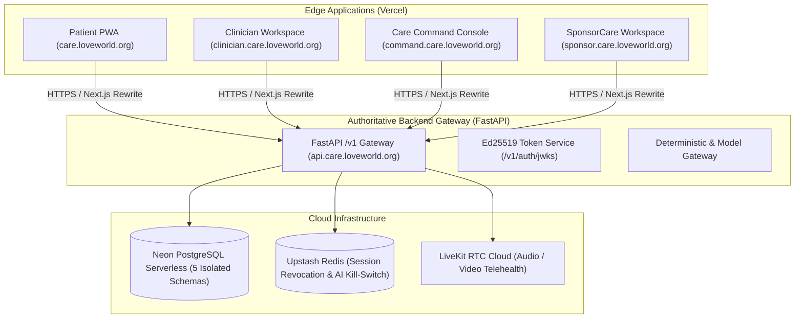

# LoveWorld Care: Deployment Architecture (Neon & Vercel)

This document describes the production deployment topology, environment configuration, database migrations, and Vercel project setups for the LoveWorld Care platform (§12, §16, §21, §25).

---

## 1. Architecture Topology



---

## 2. Neon PostgreSQL Database

### 2.1 Isolated Schema Architecture
The authoritative database runs on Neon PostgreSQL serverless across five logically isolated schemas:
1. `identity`: Patient identities, clinician MDCN credentials, roles, and session records.
2. `care_clinical`: Episodes, intake answers, encounters, appointments, documents, and addenda.
3. `finance_ledger`: Double-entry journal entries, sponsor pool agreements, reservations, and payables.
4. `governance_audit`: Append-only cryptographic HMAC audit event chain.
5. `analytics`: Differential-privacy ($k \ge 5$) views for sponsor reporting and executive metrics.

### 2.2 PostgreSQL Immutability Triggers
All signed clinical records, addenda, ledger entries, and audit logs are protected by database-level `BEFORE UPDATE OR DELETE` triggers:
- `trg_immutable_signed_clinical_documents`
- `trg_immutable_clinical_addenda`
- `trg_immutable_finance_ledger_entries`
- `trg_immutable_governance_audit_events`

### 2.3 Executing Migrations
To run schema creation, trigger installation, and idempotent seeding against Neon:
```bash
python -c "
import asyncio, os
from lw_care_api.db.neon_migrator import NeonDatabaseManager
asyncio.run(NeonDatabaseManager(os.environ['LW_DATABASE_URL']).migrate_and_seed())
"
```

---

## 3. Vercel Deployment Guide

### 3.1 Four Standalone Vercel Projects
Create 4 separate projects in Vercel to maintain origin and audience isolation:

| Application | Vercel Project Name | Root Directory | Production Domain | Audience Scope |
|---|---|---|---|---|
| **Patient PWA** | `loveworld-care-patient` | `apps/patient-web` | `care.loveworld.org` | `lwc:patient` |
| **Clinician Workspace** | `loveworld-care-clinician` | `apps/clinician-web` | `clinician.care.loveworld.org` | `lwc:clinician` |
| **Care Command** | `loveworld-care-command` | `apps/command-web` | `command.care.loveworld.org` | `lwc:command` |
| **SponsorCare** | `loveworld-care-sponsor` | `apps/sponsor-web` | `sponsor.care.loveworld.org` | `lwc:sponsor` |

### 3.2 Environment Variables (Per App in Vercel Dashboard)
For each project in Vercel:
- `FASTAPI_BACKEND_URL`: URL of the deployed FastAPI service (e.g., `https://api.care.loveworld.org`).
- `NEXT_PUBLIC_APP_ENV`: `production`

### 3.3 Deploying via Vercel CLI
```bash
# 1. Login to Vercel
vercel login

# 2. Deploy Patient PWA
cd apps/patient-web
vercel --prod

# 3. Deploy Clinician Workspace
cd ../clinician-web
vercel --prod

# 4. Deploy Care Command
cd ../command-web
vercel --prod

# 5. Deploy SponsorCare
cd ../sponsor-web
vercel --prod
```

---

## 4. Deploying the FastAPI Backend Service

The FastAPI application (`services/api`) requires Python 3.11+ and connects to Neon and Upstash Redis. It can be deployed on a container or Python runtime platform:
- **Build Command**: `uv sync --frozen`
- **Start Command**: `uvicorn lw_care_api.main:create_app --factory --host 0.0.0.0 --port $PORT`
- **Required Secrets**:
  - `LW_ENVIRONMENT`: `production`
  - `LW_DATABASE_URL`: Neon connection string (`postgresql+asyncpg://...`)
  - `LW_UPSTASH_REDIS_REST_URL`: Upstash Redis REST URL
  - `LW_UPSTASH_REDIS_REST_TOKEN`: Upstash Redis token
  - `LW_TOKEN_SIGNING_SEED_HEX`: 64-hex-char Ed25519 signing seed
  - `LW_CLINICAL_SIGNING_SEED_HEX`: 64-hex-char Ed25519 clinical signer seed
  - `LW_AUDIT_HMAC_CHAIN_KEY`: 64-hex-char HMAC secret key
  - `LW_CORS_ORIGINS`: Comma-separated HTTPS origins (`https://care.loveworld.org,https://clinician.care.loveworld.org,https://command.care.loveworld.org,https://sponsor.care.loveworld.org`)
