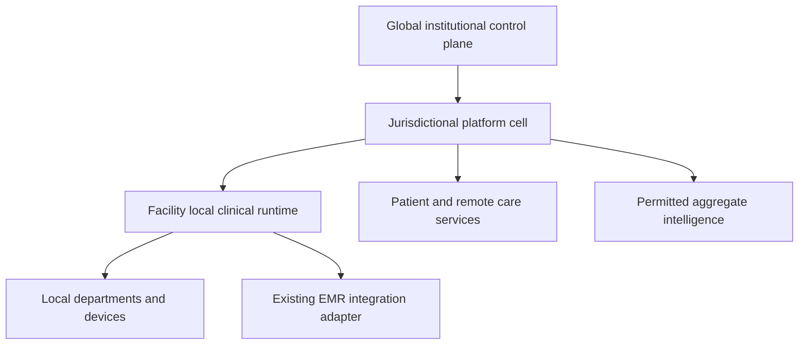

# Platform architecture, system context and integration strategy

## Architecture decision

Build one platform with distinct workspaces: LW Health Leadership, LW Health Command, LW Health Coordination, LW Health Facility Workspace, LW Care Clinical Workspace, My LW Health Care and LW Health Programmes. Shared identity, organisation IDs, policy, registry, audit and data contracts prevent duplicated products. Existing deployed Care applications are candidates for reuse after a repository/data audit; this suite makes no claim that their advertised technology or controls are verified.

## Runtime topology

The global control plane holds ministry hierarchy, network policy references, public directory metadata and permitted institutional information. Jurisdictional cells hold authorised identity/care data and integration services according to an adopted country package. The facility runtime remains the authoritative writer for that facility's clinical encounters, orders, administrations and local stock during both connected and disconnected operation. Cloud readers and remote commands respect that authority; they do not create an independent competing clinical writer during a partition.

## Component and authority contract

| Component | Responsibility | Authoritative information |
|---|---|---|
| Identity/policy service | Accounts, grants, purpose-scoped decisions | Memberships, grants and role epochs |
| Network service | Facility master, affiliation casework, service catalogue | Central recognition decisions and registry IDs |
| Reporting service | Obligations, return versions, review and corrections | Submitted/verified return snapshots |
| Clinical runtime | Chart, encounters, ADT, nursing, orders, results, medicines, procedures | Facility-origin clinical transactions |
| Exchange gateway | Matching, authorised summaries/documents, partner adapters | Disclosure/access receipts; source records remain attributed |
| Clinical finance service | Charges, invoices, receipts, payer claims, entitlements | Append-only care ledgers and reservations |
| Analytics service | Governed measures, coverage, snapshots and disclosure | Versioned aggregates derived from source evidence |
| Workflow/job service | Owned tasks, retries, deadlines, notification | Durable work state and delivery receipts |
| Intelligence runtime | Bounded retrieval, drafting and approved clerical automation | No independent authority over clinical/affiliation truth |

## Technical implementation profile

Recommended reference architecture: a web/PWA experience with accessible component contracts; API services enforcing domain permissions; relational transactional storage; private object storage; durable outbox/inbox and background jobs; policy/version registries; and independent observability. A facility package runs the required API, relational database, authentication verifier/local identity functions, terminology/form/policy packages, file storage, printing and department adapters on the local network. Containers and repeatable provisioning are suitable deployment units. Exact frameworks/vendors are selected after audit, supportability, licensing and cost assessment. Optional accounting/HR systems integrate through event and reconciliation adapters.

## Data movement and clinical consistency

Every clinical change commits record + audit + outbox atomically at its authority node. Acknowledgement identifies local durability and later replication separately. Receivers validate identity, node authority, permission snapshot, version, signature/hash where used, idempotency and references. Conflicts are explicit domain tasks; signed notes, medication administrations, stock movements and ledger entries never use last-write-wins. Global matching links identities through reviewed crosswalks without destructively merging source records.

Regional/global reporting is generated from approved indicators or submitted returns. Raw notes, precise identifying combinations and linkable patient keys do not flow into general executive analytics. A reporting correction creates a new version and recomputes affected snapshots with lineage. Clinical event ingestion and a facility's declared return are reconciled, not added together automatically.

## Offline and external dependencies

Full local clinical operation is a core requirement. A service-worker cache alone does not satisfy it. Clinical staff can register, assess, order, document, administer, dispense, manage wards/procedures, discharge, bill and print using locally available systems. External laboratory services, interfacility acceptance, cloud AI, payment settlement and remote communications remain pending/unavailable until actually confirmed. Local receiving departments and instruments must be qualified for disconnected operation.

Facility power/LAN failure, hardware loss and WAN loss are separate scenarios. Local backup, UPS, storage, failover and manual contingency are qualified under LWH-SPEC-015/017. Global or regional outages cannot turn a queued external action into a successful-looking result. Remote access after a partition shows freshness and a request-for-acceptance state.

## Architecture decision records

ADR-01 one product/multiple workspaces; ADR-02 administrative hierarchy separate from clinical authority; ADR-03 global control plane plus jurisdictional cells; ADR-04 facility-authoritative clinical writes; ADR-05 relational transactions plus outbox; ADR-06 FHIR/document and departmental adapters for exchange; ADR-07 optional ERP boundary; ADR-08 bounded AI with AI-off continuity. Each ADR is accepted as a design proposal in this suite and must be reconciled against repository evidence and adopted jurisdiction packages before implementation commitments.
