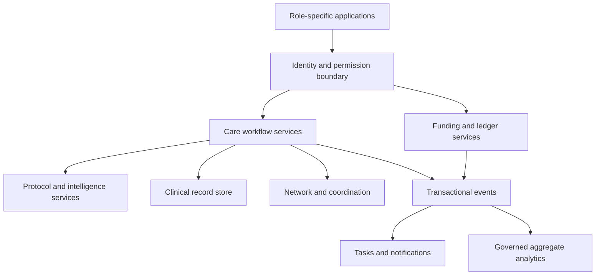

# LoveWorld Care Overhaul Blueprint

LoveWorld Care is a public-facing health intelligence and care delivery platform with a clear LoveWorld identity. It provides useful immediate assistance, understands a person's health context over time, supports accountable professional care and helps leadership improve access, continuity, quality and sustainable delivery.

The product promise is: **understand the person, make the next appropriate step easy, and remain attentive until care responsibilities are resolved or explicitly transferred.**

This document translates the collaborative vision captured on 2 November 2026 into implementable requirements. It is a new engineering blueprint, not a claim that the inspected deployments implement these requirements, and not a replacement for approved clinical operating policies. No drug instructions, clinical thresholds or diagnostic rules are authorised by this document.

## 0. Navigation, reference conventions and agent execution contract

### LWC-DOC-001 — Reading routes

| Reader | Read first | Then use |
|---|---|---|
| Product/design | Sections 1–7 | Journeys in 8; states in 10; tests in 17 |
| Engineering agents | This section; 2; 9–12 | Screen contracts in 5–7; delivery in 18 |
| Clinical leadership | 3; 6; 8–10 | Network operations in 13; assurance in 16–17 |
| Directorate | 1–3; 7; 14–15 | Decisions in 19; release gates in 17 |
| Finance/sponsors | 7; 10; 14 | Security in 16; tests in 17 |
| QA/security | All MUST requirements | State guards, negative tests, evidence manifest |

### LWC-DOC-002 — Stable references

IDs use `LWC-{DOMAIN}-{NNN}`. The heading or table row containing the ID is its authoritative definition. IDs remain stable across revisions; do not renumber existing IDs. References elsewhere do not create another definition. Split requirements by adding new IDs and recording the relationship; retire IDs with a replacement reference rather than silently deleting them.

| Prefix | Meaning |
|---|---|
| DOC | Document and agent contract |
| VIS / DEC | Confirmed vision / decision register |
| OBS | Historical inspection observation |
| PRN / SCP | Product principle / scope |
| ACC / ACL | Account model / access rules |
| UX / SCR | Cross-product behaviour / screen contract |
| JRN | End-to-end journey |
| INT / MEM / PRT | Intelligence permissions / memory / protocol contract |
| STM | State machine |
| DAT / API / EVT | Data object / operation / event |
| NET / OPS | Network operations / service operations |
| ECO / MET | Economics / metric |
| SEC / REL | Security / reliability |
| AT / GAT | Acceptance test / release gate |
| DEL / RSK / SRC | Delivery / risk / source |

### LWC-DOC-003 — Normative language and status

- **MUST:** required for the stated scope; failure blocks the associated release gate.
- **SHOULD:** preferred implementation; an accountable owner documents any exception.
- **MAY:** optional capability.
- **CONFIRMED:** user-confirmed product direction, not regulatory approval.
- **PROPOSED:** design or operating choice awaiting the named owner’s decision.
- **APPROVAL_REQUIRED:** cannot be activated without recorded approval and evidence.
- **DEFERRED:** architecture preserves an extension point; no working feature is implied.

Every pilot-scoped requirement is mandatory unless explicitly marked SHOULD/MAY. Numeric targets introduced here are proposed engineering or service targets, not existing contractual promises. Missing clinical thresholds remain unset and block activation; agents MUST NOT supply plausible defaults.

### LWC-DOC-004 — Requirement and issue schema

Implementation tickets MUST contain this structure, or an equivalent structured record:

```yaml
id: LWC-SCR-101
title: Patient Today
status: proposed
priority: P0
release: pilot
owner: product
accountable: service_product_owner
actors: [patient, authorised_proxy]
depends_on: [LWC-ACC-001, LWC-ACL-001, LWC-STM-001]
inputs: [active_subject, active_episodes, due_tasks]
outputs: [rendered_next_actions]
permissions: subject_scoped_read
failure_behaviour: preserve_last_sync_time_and_offer_retry
acceptance: [LWC-AT-004, LWC-AT-019]
evidence: []
implementation_status: not_started
```

### LWC-DOC-005 — Agent guardrails

Agents MUST read dependencies before editing a feature; preserve account/subject separation; enforce permissions on the server; use integer minor units for money; and implement error, empty, loading, stale and denied states. A button label, local fixture, mock response or passing UI snapshot is not proof of an operational capability. Tests must exercise authoritative persistence and permission boundaries where relevant.

Agents MUST NOT fabricate medical content, operating hours, licensed-provider status, facility readiness, financial balances, consent, integration success, clinical signatures or production metrics. Never ship synthetic cases in production tenants. Do not populate clinical forms with demonstration treatments. No autonomous production migrations, deployments or clinical policy activation is authorised merely by this blueprint.

Implementation completion requires: requirement IDs; changed components; migration and rollback notes; meaningful test evidence; known limitations; and the owner’s release decision. A backend failure must not silently switch to successful-looking demo data.

### LWC-DOC-006 — Source precedence and reconciliation

For product intent, explicit decisions in this conversation override conflicting v1.0 product emphasis. Approved clinical policy, current law and signed operating contracts remain separate authorities; this document cannot override them. Preserve v1.0 safety, consent, financial segregation and clinical accountability requirements unless an authorised change record replaces them. Resolve conflicts explicitly in LWC-DEC-001 rather than silently choosing the more permissive interpretation.

## 1. Confirmed vision and consequences

| ID | Confirmed decision | Consequence |
|---|---|---|
| LWC-VIS-001 | Health intelligence is the centre of gravity, spanning personal care and operations | Build shared contextual intelligence behind multiple role-specific experiences |
| LWC-VIS-002 | Prioritise patients, clinicians and Directorate leadership | Complete their connected journeys before expanding secondary portals |
| LWC-VIS-003 | Immediate assistance and minimal unnecessary waiting | Offer useful bounded assistance immediately; give truthful human-response commitments |
| LWC-VIS-004 | AI supports approved low-risk pathways; clinicians remain clinical authorities | Separate permitted protocol actions from new diagnosis/treatment decisions |
| LWC-VIS-005 | Personalisation grows with the patient | Maintain longitudinal, correctable context with provenance and bounded permissions |
| LWC-VIS-006 | Personal/family/maternal health, chronic support, medication and follow-up are initial priorities | Establish programme-specific scope and accountable teams; maternal pathways require specific approval |
| LWC-VIS-007 | Duty teams, participating networks and usual-care relationships coexist | Matching must consider continuity, capability, coverage and workload |
| LWC-VIS-008 | Clinician assistance covers summaries, notes, results/follow-up, scheduling, references and handovers | Human oversight focuses on consequential clinical decisions |
| LWC-VIS-009 | Location, proximity, capability and operational feasibility inform escalation | Facility discovery is separate from confirmed acceptance or dispatch |
| LWC-VIS-010 | One personal account with optional dependants and authorised caregiver access | Actor, patient subject, payer and organisation remain distinct |
| LWC-VIS-011 | Open to the public with a clear LoveWorld identity | No compulsory church membership or assumed religious title |
| LWC-VIS-012 | Free core companion with paid care and institutional/sponsor models | Separate entitlement, clinical urgency and payment state |
| LWC-VIS-013 | Dashboard plus conversation; voice and additional languages later | Text-first pilot, accessible responsive design; no decorative voice controls |
| LWC-VIS-014 | Real controlled pilot; network grows continuously | Activate services only against verified readiness; expand by gated cohorts |

### LWC-PRN-001 — Attentive service

Every active episode MUST expose its current status, next action, accountable owner/team and next expected update where a commitment exists. Silence is not completion. The patient should not need to chase several portals to understand one episode.

### LWC-PRN-002 — Low administrative burden

Collect only information needed for the current purpose. Reuse verified information with a “still correct?” confirmation where freshness matters. Allow progressive onboarding, resumable drafts and optional fields. Safety-critical unknowns MUST remain unknown, never default to “no”.

### LWC-PRN-003 — Clinical and commercial independence

Funding status does not determine emergency guidance or clinically assigned urgency. Paid tiers do not bypass necessary clinical checks. Capacity shortages must be visible; an AI acknowledgement is not evidence that a clinician has reviewed a case.

### LWC-PRN-004 — Calm, clear interface

Use restrained LoveWorld branding, readable typography, plain language, deliberate spacing and consistent components. Avoid developer terms, specification section numbers, cryptographic algorithms and vendor names in ordinary user flows. Keep technical evidence in authorised audit views. Do not overload the patient home with all possible services.

## 2. Evidence baseline, scope and overhaul boundaries

### LWC-OBS-001 — Inspection evidence and limitations

The primary domains were inspected on 2 November 2026. Findings below are historical interface observations, not current backend or security findings. No transactions, clinical signatures, case claims or kill-switch actions were submitted. Source code and full authenticated journeys were not audited. Deployment-specific alternative URLs were not compared.

| ID | Observed surface | Observation | Required response |
|---|---|---|---|
| LWC-OBS-002 | Patient portal | Thin home, empty care view, welcome-only message view, profile dominated by privacy/login text | Implement longitudinal home, records, care tasks and account management |
| LWC-OBS-003 | Clinician workspace | Empty queue alongside selected case, prefilled assessment/treatment and MFA field | Remove fixtures from live mode; enforce selected-case consistency and deliberate entry |
| LWC-OBS-004 | Care Command | Illustrative unit economics, governance controls and narrow operations view | Separate role capabilities; expose measured metrics and actionable exceptions |
| LWC-OBS-005 | Sponsor portal | One agreement, balances and cohort-simulation checkbox | Implement programme lifecycle and clearly isolate demonstration functions |
| LWC-OBS-006 | Multiple portals | Role-labelled screens opened without reviewer login; synthetic roster shown as available | Verify authentication and environment mode; do not infer a proven bypass |
| LWC-OBS-007 | API root | Operational text only | Require endpoint, persistence, security and recovery evidence |

### LWC-SCP-001 — Pilot scope

Pilot includes: account and subject identity; consent and proxy access; text companion; patient home and history; clinician worklist; bounded approved protocol execution; asynchronous/callback/scheduled consultations; clinical documentation and care plans; medication reminders; follow-up/results tasks; location-aware referral coordination; staffed operations; essential leadership metrics; self-pay and at least one fully validated funding route used by the cohort; reconciliation; audit; monitoring and support.

Clinical leadership chooses the first supported populations and conditions. Family account capability does not imply paediatric remote-care activation. Maternal tracking may begin with approved appointment, education and follow-up functions while assessment pathways remain gated. Each service has a published eligibility and exclusion policy.

### LWC-SCP-002 — Expansion scope

Continuous network onboarding is in scope. Additional care programmes, specialties, institutions, facility integrations and sponsor programmes activate individually. Manual verified intake of records may precede automated integrations. Connected-device ingestion, broader record exchange, voice and additional languages are deferred unless separately approved and tested.

### LWC-SCP-003 — Non-goals for this pilot

No autonomous new diagnosis or prescribing outside an explicitly approved intended-use assessment; no universal emergency dispatch promise; no assumed 24/7 clinician coverage; no full hospital information system replacement; no default recording of consultations; no sale of identifiable health data; no universal insurance or unlimited-care promise; no automatic model training on patient conversations.

### LWC-SCP-004 — Product topology

Preserve separate patient, professional, operational and sponsor experiences where helpful. Use a shared identity service and common contracts, not broad cross-portal permissions. Whether these remain four deployments is an engineering decision after repository review. A shared backend with clear modules is the proposed default; a rewrite of proven modules is not required merely for consistency of appearance.

## 3. Accountability and operating roles

| ID | Role | Accountable responsibilities | Explicit boundary |
|---|---|---|---|
| LWC-OPS-001 | Clinical service owner | Approved services, clinical governance, patient-service accountability, clinician contracts | Cannot delegate clinical policy approval to software agents |
| LWC-OPS-002 | Product owner | Journeys, prioritisation, accessibility, experience acceptance | Cannot approve medical thresholds |
| LWC-OPS-003 | Treating clinician | Review, assessment, treatment decisions, signing, follow-up and handover | No unrelated records access |
| LWC-OPS-004 | Clinical governance lead | Protocols, safety case, incident review, quality sampling, clinical release gates | No unilateral financial payout approval |
| LWC-OPS-005 | Care coordinator | Scheduling, follow-through, facility contact, unresolved operational tasks | Clinical actions only within separately credentialled scope |
| LWC-OPS-006 | Network operations lead | Provider/facility onboarding, readiness, availability and contracts | Verification badge requires evidence |
| LWC-OPS-007 | Finance lead | Ledger, reconciliation, refunds, payer contracts, payouts and pricing | No unrestricted clinical narratives |
| LWC-OPS-008 | Privacy/security leads | Purpose-based access, data rights, incidents, vendor assessments | Privilege does not confer routine clinical access |
| LWC-OPS-009 | Directorate | Outcomes, coverage, resources, programme performance and action tracking | Aggregate default; named patient access requires separate authorised role |
| LWC-OPS-010 | Prolific Intelligence | Software, integrations, infrastructure, reliability and managed technical service | No implied ownership of patient records or clinical authority |

### LWC-OPS-011 — Ownership continuity

Each service queue has a staffed accountable team and escalation contact. A clinician must explicitly acknowledge assignment; until then the queue owner remains responsible. Handover transfers responsibility only on acceptance. End-of-shift transfer must enumerate unresolved cases, due tasks and contingencies. A record of “message sent” is insufficient.

### LWC-OPS-012 — Overrides

Clinicians may correct drafts and override routing within their scope, with appropriate reason, provenance and audit. Overrides cannot bypass expired credentials, subject isolation, financial segregation or legal limits. Higher-risk clinical overrides require the approval/escalation rule specified in the relevant protocol. UI must distinguish clinical discretion from security-control bypass.

## 4. Accounts, profiles, organisations and permissions

### LWC-ACC-001 — Separate identity objects

| Object | Purpose | Minimum attributes |
|---|---|---|
| Account | Authenticated human actor | account_id, verified channels, auth methods, session controls, status |
| PatientSubject | Person receiving care | patient_id, demographics needed for care, jurisdiction, record links |
| CareRelationship | Authority to act for another subject | actor, subject, authority basis, scope, proof, validity, revocation |
| ClinicalProfile | Longitudinal health context | provenance-tagged conditions, medications, allergies, observations and care plans |
| Organisation | Facility, clinical operator, institution or sponsor | legal/operating identity, type, verified contacts, contracts |
| Membership | Actor’s organisational role | org_id, roles, scopes, validity, approval |
| PayerAgreement | Funding rules | payer, beneficiaries/policy, services, limits, dates, financial terms |

One adult may be a patient, a clinician and a sponsor administrator, but MUST choose an explicit workspace context. A clinical role must not inherit access from a family relationship or vice versa. Email is a contact/login attribute, never the patient record’s primary key.

### LWC-ACC-002 — Progressive registration

Public users can view service information, coverage and approved emergency guidance without registration. Persistent personalised care requires verified account access and patient linkage. Ask initially for the minimum necessary identity/contact and service eligibility information; collect clinical information when the selected journey requires it. Explain why each sensitive question is needed. Do not require religious affiliation, detailed address or a full medical history for basic browsing.

### LWC-ACC-003 — Authentication and recovery

Support a verified passwordless method with rate limits, short-lived single-use tokens, redirect allowlisting and secure sessions. Privileged roles require MFA and sensitive-action reauthentication. Recovery must verify the actor without revealing whether another patient exists. A verified contact change triggers notification and risk review; merging records requires human review with reversible linkage history. No example MFA values in live forms.

### LWC-ACC-004 — Family and caregiver relationships

An adult invitation grants no access until the subject or a legally authorised mechanism approves defined scopes. Scopes include booking, billing, care-plan view, reminders and specified records; do not bundle all scopes by default. Guardian authority for a dependant requires an approved process. Record authority expiry, disputes and transition at the age/condition requiring renewed authority. Age rules must be approved for the service jurisdiction, not hard-coded from developer assumptions.

### LWC-ACC-005 — Active subject context

Every care screen shows “Care for: [subject]”. Switching subject cancels or explicitly rebinds unsent drafts, changes cached data scope and resets conversation context. A prescription, payment, message or referral confirmation must name the intended subject. Clinical details must never leak through another family member’s notification preview.

### LWC-ACC-006 — Profile controls

Users can edit contact/preferences, submit corrections to clinical data, manage devices and sessions, review permissions, request records and manage notification settings. Patient edits do not overwrite signed clinical facts; they create attributed updates for review. Revoking a proxy invalidates access, signed URLs and future notifications promptly while preserving audit and legally required records.

### LWC-ACL-001 — Permission evaluation

Server evaluates actor identity, workspace, organisation, patient relationship or case assignment, purpose, requested action, field sensitivity, credential status and consent/other lawful authority. Deny by default. UI visibility is not access enforcement. Object IDs supplied by the client never establish permission.

| ID | Actor | Permitted default | Denied default |
|---|---|---|---|
| LWC-ACL-002 | Patient | Own permitted records, tasks, payments and care | Another adult’s records |
| LWC-ACL-003 | Proxy | Explicitly granted subject/action scopes | Unscoped records or sharing |
| LWC-ACL-004 | Clinician | Assigned/authorised care context | Unrelated patients and sponsor finance |
| LWC-ACL-005 | Coordinator/support | Minimum scheduling, contact and service status | Clinical narratives unless separately authorised |
| LWC-ACL-006 | Finance | Financial events and minimum identifiers | Full clinical notes |
| LWC-ACL-007 | Sponsor/institution | Contract, financials and approved aggregates | Identifiable clinical information |
| LWC-ACL-008 | Directorate | Aggregate outcomes and operating actions | Patient browsing by default |
| LWC-ACL-009 | Platform administrator | Technical operations with audited privileged access | Routine plaintext clinical access |

### LWC-ACC-007 — Account lifecycle

States: `PENDING_VERIFICATION → ACTIVE → RESTRICTED / SUSPENDED → CLOSED`. Closure ends access according to policy but does not erase records required for lawful retention. Restricted accounts must retain a safe route for urgent guidance and account support. Clinical, financial and identity restrictions are separate flags with explicit reasons and appeal paths.

## 5. Patient experience and screen contracts

### LWC-UX-001 — Navigation

Recommended patient navigation: **Today, Companion, My Care, Records, Account**. Appointments, medications and family are reachable from relevant home cards and their owning sections. Avoid duplicate sources of truth. Text conversation and structured screens update the same authoritative objects.

### LWC-UX-002 — Universal screen states

Each screen MUST implement: loading without invented values; meaningful empty state; permission denial without data leakage; retriable errors; stale-data timestamp; offline status; success backed by server acknowledgement; and clear cancellation where possible. Retry must preserve entered data securely and avoid duplicate side effects. Do not display an unsent message as delivered.

### LWC-UX-003 — Interaction design

Proposed default: show no more than three prioritised next actions on Today, with the full list available. Clinical urgency outranks engagement prompts. Ask one short question or a compact related group in conversation; show progress without pretending a variable clinical intake has a fixed length. Never hide a required safety question merely to meet a click-count target.

### LWC-SCR-101 — Today

- **Purpose/owner:** patient orientation; Product owns UX, coordinator owns operational task accuracy.
- **Content:** active subject; concise greeting; current episode status; next action; appointments; due care-plan tasks; selected progress summary; obvious “Get help” and “Ask Companion”.
- **Behaviour:** prioritise unresolved care over promotion. Each card opens its source task/episode. Show last update and expected next update where committed. A new user sees useful starting actions, not empty charts.
- **Failure:** stale care cards remain labelled; unavailable services show alternatives. No artificial “all healthy” state from missing data.
- **Acceptance:** LWC-AT-004, LWC-AT-019.

### LWC-SCR-102 — Companion

- **Purpose/owner:** immediate contextual assistance; Clinical governance owns permitted content, Product owns interaction.
- **Content:** persistent text thread, selected subject, source-backed answer cards, structured confirmations, current episode link and escalation status.
- **Behaviour:** distinguish general information, approved pathway output and clinician communication. Ask before adding uncertain statements to a profile. Offer direct task actions such as review a care plan or request a callback. Do not force chat for actions available through navigation.
- **Failure:** inference timeout presents saved structured intake or human options. Unsafe/unavailable protocol exits to a truthful alternative. A bot reply is never labelled a doctor's reply.
- **Acceptance:** LWC-AT-005, LWC-AT-006, LWC-AT-018.

### LWC-SCR-103 — Get help / intake

- **Content:** reason for help, relevant safety questions from active approved protocol, patient context confirmation, available service modes and transparent price/coverage.
- **Behaviour:** preserve patient wording alongside extracted fields. Confirm consequential ambiguity. Do not ask already-current information unnecessarily. Location can be entered manually; device location is optional and purpose-limited. Route emergency guidance without payment/account dependency.
- **Failure:** unknown age/location or missing critical answers produces an explicit unresolved state; no automatic negative screening. Drafts resume safely after interrupted connectivity.
- **Acceptance:** LWC-AT-005, LWC-AT-008, LWC-AT-012.

### LWC-SCR-104 — Active care episode

- **Content:** plain-language state, responsible team, acknowledgement status, outstanding questions, next update, appointment/callback details and history of meaningful transitions.
- **Behaviour:** let patients leave and return without losing their place. Show “request received” until a clinician actually acknowledges. Changes in timing trigger clear updates and alternatives. “Cancel” explains care and payment consequences before confirmation.
- **Failure:** overdue commitments create an operational task and update the patient; never silently reset a timer.
- **Acceptance:** LWC-AT-007, LWC-AT-009, LWC-AT-010.

### LWC-SCR-105 — Consultation

- **Content:** clinician identity/status, patient confirmation, consent, connection check, secure messages and video/audio where supported.
- **Behaviour:** explain mode limitations, provide reconnection and appropriate fallback, retain draft notes and record consultation start/end separately from signing. A technical disconnect is not clinical completion.
- **Failure:** failed connection offers reschedule/callback per policy and opens an accountable exception; charging follows the contract, not call duration alone.
- **Acceptance:** LWC-AT-010, LWC-AT-013.

### LWC-SCR-106 — My Care / plan

- **Content:** active programmes, clinician-approved plan, goals, due actions, referrals and follow-up. Clearly identify author, review date and version.
- **Behaviour:** patient can mark a task done, report difficulty or ask a question. Self-reported completion is distinct from clinician verification. New symptoms create a review pathway rather than quietly altering the plan.
- **Failure:** expired plans are flagged for review; stale content remains contextual, not silently revalidated.
- **Acceptance:** LWC-AT-014, LWC-AT-015.

### LWC-SCR-107 — Medications and routines

- **Content:** source-labelled medication list, clinician-approved instructions, reminder schedule, reported adherence and reconciliation requests.
- **Behaviour:** user may adjust reminder timing within the approved instruction constraints; changes to dose/frequency require clinician action. Support “not taking”, “need help”, “supply issue” and correction requests. Do not treat a dismissed notification as a taken dose.
- **Failure:** conflicting or unclear medication instructions trigger review and avoid generating a reconciled instruction without authority.
- **Acceptance:** LWC-AT-015, LWC-AT-024.

### LWC-SCR-108 — Records and progress

- **Content:** timeline, encounters, observations, uploaded documents, results, signed plans, referrals and correction requests. Show source, date, units and verification state.
- **Behaviour:** useful filters, accessible trends, missing-data disclosure, authorised download and controlled sharing. A trend is not a diagnosis. Uploaded results enter a review workflow; AI extraction remains a draft until appropriately confirmed.
- **Failure:** unsupported units, poor scans or identity mismatch produce review tasks instead of guessed values.
- **Acceptance:** LWC-AT-016, LWC-AT-024.

### LWC-SCR-109 — Appointments and referrals

- **Content:** real slots, service scope, clinician/facility capability, modality, price, cancellation policy and referral status.
- **Behaviour:** reserve atomically; display booking only after confirmation. Facility acceptance and scheduled appointment are separate facts. A declined referral returns to an owned task with alternatives.
- **Failure:** stale slots produce a refreshed choice without duplicate payment. No suitable nearby facility results in a truthful explanation and operational escalation.
- **Acceptance:** LWC-AT-008, LWC-AT-012.

### LWC-SCR-110 — Account, family and privacy

- **Content:** personal details, communication preferences, family relationships, caregiver permissions, consent history, devices/sessions and rights requests.
- **Behaviour:** scoped invitations, explicit subject switching, correction requests and accessible recovery. Optional preferred name/title; neutral default greeting.
- **Failure:** disputed authority suspends disputed access for review; do not merge records on matching names alone.
- **Acceptance:** LWC-AT-001, LWC-AT-002, LWC-AT-003.

### LWC-SCR-111 — Coverage and billing

- **Content:** relevant entitlements, service price, what is included, copay if any, receipts, refunds and programme expiry.
- **Behaviour:** use plain patient language rather than escrow architecture. Clearly distinguish funds requested, pending, confirmed and refunded. Explain uncovered services before financial commitment.
- **Failure:** payment uncertainty shows pending verification; retry consults the original transaction. Emergency guidance remains accessible.
- **Acceptance:** LWC-AT-011, LWC-AT-017.

### LWC-SCR-112 — Notifications and support

- **Content:** in-app inbox, communication preferences, case-linked updates and support tickets.
- **Behaviour:** neutral external previews; thread linked to the right episode/subject; quiet hours and opt-out controls for optional reminders; delivery failures create fallback tasks when service-critical. Explain clinical response windows before message submission.
- **Failure:** sent, delivered, read and clinically acknowledged are separate states. Support does not provide unapproved clinical answers.
- **Acceptance:** LWC-AT-009, LWC-AT-014, LWC-AT-025.

## 6. Clinician experience and work contracts

### LWC-SCR-201 — My work

The default professional home shows assigned cases, review requests, due results, outstanding notes, follow-up and handover tasks. Tabs distinguish available work from personally accepted responsibility. Filters include urgency, due time, service, continuity relationship and task type. Priority uses clinically approved rules, not patient spending or engagement scores. Each task displays reason, age, owner and next required action. Empty queues must not show a selected unrelated fixture. Owner: clinical operations; acceptance: LWC-AT-007, LWC-AT-019.

### LWC-SCR-202 — Patient workspace

Use a concise summary with expandable history, current reason, verified medications/allergies, relevant observations, prior care plans, patient wording and uncertainties. Show the source and date behind each AI summary claim. The clinician can open underlying records, correct a draft and request clarification. Missing information is explicit; a summary must not imply an examination occurred. Separate patient-reported findings, extracted values, clinician findings and hypotheses. Owner: treating clinician; acceptance: LWC-AT-006, LWC-AT-024.

### LWC-SCR-203 — Encounter and documentation

Display consultation controls alongside editable structured notes. AI drafts are marked and never pre-signed. The clinician confirms patient, scope, suitability, relevant findings, assessment, plan, safety-net and follow-up according to the approved service template. Signing produces an immutable version and actor-bound provenance. Later corrections are addenda. A signature requires valid credentials, assignment and step-up verification where policy requires it. Signing a record must not automatically declare referral completion or cash settlement. Owner: clinical lead; acceptance: LWC-AT-013.

### LWC-SCR-204 — Results and follow-up inbox

Every ordered or received result has an accountable reviewer and due time. Deduplicate repeated uploads without discarding corrected versions. Show criticality only from an approved rule or clinician classification. A result is not completed merely because a patient opened it. Track review, patient communication, resulting action and closure separately. An absent clinician’s tasks pass through accepted handover. Owner: clinical operations; acceptance: LWC-AT-014, LWC-AT-016.

### LWC-SCR-205 — Care plan builder

Clinician approves goals, actions, medication instructions where applicable, check-in schedule, escalation rules, review date and responsible team. AI may draft from reviewed encounter facts, but patient-facing clinical instructions require the approval defined by the service. Patient preferences and practical barriers are visible. Publishing a new version records differences and supersedes future tasks safely without erasing historical completion. Owner: treating clinician; acceptance: LWC-AT-015.

### LWC-SCR-206 — Referral and handover

Show required capability, patient-approved sharing scope, appropriate facilities, readiness freshness, receiving contact and referral packet preview. Clinician/coordinator submits only to a permitted recipient. Track request, acceptance, appointment/arrival where confirmed, outcome and return responsibility. Declines and timeouts remain owned. No clinician can discharge responsibility by merely sending a message. Owner: clinical operations; acceptance: LWC-AT-012, LWC-AT-014.

### LWC-SCR-207 — Schedule, availability and profile

Clinicians manage availability within contracted services, see upcoming commitments, continuity panels and workload. Availability changes protect existing cases and trigger coverage workflows. Profiles expose verified scope, credential expiry, training and technical-readiness status; self-editing does not confer verification. Compensation statements are separate from clinical decision views. Owner: network operations; acceptance: LWC-AT-007, LWC-AT-020.

### LWC-SCR-208 — Clinical reference assistant

Retrieve approved references with title, issuing body, version/date and relevant passage/context. Distinguish quoted evidence from generated synthesis. Display uncertainty and local applicability; never invent a citation. References support clinician judgment and cannot independently execute prescriptions or orders. Owner: clinical governance; acceptance: LWC-AT-006, LWC-AT-018.

## 7. Directorate, coordination, governance and sponsor screens

### LWC-SCR-301 — Directorate overview

Default panels: access/unmet demand; continuity/quality; workforce/capacity; facility/referral coverage; sponsored impact. Secondary panels cover financial sustainability, reliability and governance. Every metric shows reporting period, refresh time, definition, denominator, exclusions, source and completeness. Trend comparison uses equivalent periods. Demonstration values are never mixed with live values. Narrative AI summaries link to underlying aggregates and state uncertainty.

Clicking a metric opens an authorised aggregate breakdown, then an operational exception if role permits. An executive role alone does not open named patient records. Actions can be assigned to accountable teams with due dates and resolution evidence. Budget and clinical approvals retain separate workflows. Owner: Directorate operations; acceptance: LWC-AT-019, LWC-AT-023.

### LWC-SCR-302 — Care coordination board

Columns represent work states: awaiting assignment, awaiting patient, callback due, referral pending, result/follow-up overdue and service exceptions. Each row has owner, urgency, due time, communication status and next action, with minimal necessary personal data. Claiming work is atomic. Bulk actions cannot disclose clinical details or mass-close unresolved clinical tasks. Owner: care coordination; acceptance: LWC-AT-007, LWC-AT-014.

### LWC-SCR-303 — Network and coverage

Show verified clinicians/facilities, service capabilities, geography, hours, readiness age, available capacity and onboarding blockers. Map view includes a list alternative. Coverage means a service can actually be delivered, not just that an address exists. Expired readiness signals are labelled and excluded from confirmed-availability claims. Owner: network operations; acceptance: LWC-AT-012, LWC-AT-020.

### LWC-SCR-304 — Clinical governance

Separate protocol drafts, review evidence, approvals, activation dates, incident reports, overrides, quality sampling and model evaluations. Display diffs and affected populations before protocol activation. Distinct authorised reviewers approve changes. AI-off controls show affected capabilities and preserved services; require reason, reauthentication and audit. Restoration requires defined checks, not merely toggling the switch back. Owner: clinical governance; acceptance: LWC-AT-018, LWC-AT-021.

### LWC-SCR-305 — Finance operations

Views: collections; restricted funds; reservations; earned revenue; payables; refunds; disputes; reconciliation exceptions. Every amount links to ledger evidence and currency. Maker/checker approval enforces distinct identities server-side; a user cannot approve their own adjustment. Clinical completion, accounting recognition and bank settlement remain separate. Owner: finance; acceptance: LWC-AT-011, LWC-AT-017.

### LWC-SCR-306 — Sponsor and institutional programme

Show programmes, agreement terms, funding history, available eligible funding, commitments, utilisation, statements and approved impact metrics. Users can request programme changes, funding instructions and renewal; beneficiary administration uses its own authorised scope and does not reveal clinical utilisation of named people. Suppress small/cohort-identifying outputs and protect against repeated-query inference. Do not claim differential privacy from a minimum cohort size alone. Owner: programme operations; acceptance: LWC-AT-017, LWC-AT-023.

### LWC-SCR-307 — Support, rights and incidents

Support sees minimum account/transaction context with documented identity verification. Clinical questions route to authorised staff. Rights requests have an owner, due date and fulfilment record. Incident views separate technical, privacy, clinical and financial details with appropriate access. No generic super-admin patient browser. Owner: support/privacy; acceptance: LWC-AT-003, LWC-AT-025.

## 8. Complete user journeys

Each journey defines a useful completion condition and a failure owner. A notification is not an outcome unless the journey explicitly ends with notification.

### LWC-JRN-001 — First visit to useful assistance

1. Visitor sees service identity, actual coverage, scope and clear emergency access.
2. User selects general information or personalised help; registration is requested only where necessary.
3. Verify account, establish patient subject, present required privacy/consent context and collect minimal eligibility details.
4. User describes need; Companion reuses known information, confirms material ambiguity and runs an eligible approved pathway.
5. Show useful permitted output with next steps, or a truthful escalation route.
6. Persist the relevant episode/task and show it on Today; let the user leave and return.

**Complete when:** the bounded information/pathway task is resolved with provenance, or accountable human work is established. **Exceptions:** unsupported jurisdiction, unknown critical details, no approved protocol or no coverage produce explicit alternatives. **Owner:** product for entry; clinical operations for unresolved care. **Tests:** LWC-AT-001, LWC-AT-004, LWC-AT-005.

### LWC-JRN-002 — Immediate bounded assistance to clinician review

1. Companion identifies an approved pathway and eligibility; records protocol version and source answers.
2. It performs only permitted actions. Uncertainty or escalation criteria create a clinician-review task.
3. Patient chooses an available suitable mode: asynchronous review, callback or scheduled consultation.
4. System shows fee/coverage and response commitment; reserves resources atomically where applicable.
5. Accountable queue receives task; clinician accepts; patient is notified of the actual state.
6. Clinician reviews context, asks only necessary follow-up questions, consults and signs the plan.
7. Patient receives understandable next steps; required follow-up tasks remain assigned.

**Complete when:** approved bounded assistance is resolved, or the signed encounter and follow-up obligations are established. **Exceptions:** timeout, patient non-response or coverage loss follows LWC-OPS-013; no false review acknowledgement. **Tests:** LWC-AT-006–010, LWC-AT-013.

### LWC-JRN-003 — Urgent/emergency escalation and facility coordination

1. An approved trigger presents fixed appropriate guidance immediately without waiting for AI, payment or login.
2. Ask current location when relevant; permit manual locality and clearly mark precision/freshness.
3. Search suitable capabilities before proximity ranking; distinguish participating and public-directory facilities.
4. Show contact/readiness limitations; do not delay immediate safety guidance while searching or contacting a partner.
5. Where a staffed coordination service exists, create an urgent owned task, request receiving acceptance and record communications.
6. Show whether contact was attempted, acceptance confirmed or coordination unavailable. Never imply transport/ambulance dispatch without verified operational integration.
7. Record confirmed handover/outcome or unresolved status and follow-up responsibility.

**Complete when:** verified receiving acceptance and defined transfer conditions are met, or documented guidance/referral disposition is recorded by authorised staff. A search result alone never closes an urgent case. **Owner:** designated clinical/coordination team within staffed scope. **Tests:** LWC-AT-005, LWC-AT-012, LWC-AT-025.

### LWC-JRN-004 — Chronic-care continuity

1. Clinician enrols an eligible patient in an approved programme and establishes baseline, goals, review date and responsibilities.
2. Patient agrees preferences and reminder/check-in frequency.
3. Companion collects relevant self-reported progress and observations without interpreting unsupported measurements.
4. Approved rules identify due reviews or concerns; no medication changes occur automatically.
5. Clinician reviews changes with contextual summary, updates plan and communicates decisions.
6. Directorate receives governed aggregate continuity measures; individual records remain scoped.

**Complete per cycle when:** due review and resulting actions are documented. The programme continues until explicit transition/closure, not until the chatbot conversation ends. **Owner:** named care team. **Tests:** LWC-AT-014–016, LWC-AT-024.

### LWC-JRN-005 — Medication and follow-up support

1. Reconcile the medication source and applicable signed instructions.
2. Patient chooses permitted reminder preferences.
3. Reminder sends neutral notification; patient reports taken, skipped, difficulty or supply issue.
4. A concern creates the approved support/review task; Companion does not invent missed-dose advice or replacement medication.
5. Clinician/coordinator resolves the appropriate issue and records the next action.
6. Changes to prescriptions update future reminders with an audit trail; historical reports remain unchanged.

**Complete when:** the concern and follow-up action are resolved, or accepted by a new accountable owner. **Tests:** LWC-AT-015, LWC-AT-024, LWC-AT-025.

### LWC-JRN-006 — Family/dependant care

1. Account holder requests a dependant link or invites an adult.
2. Verify authority and grant specific scopes using the approved process.
3. Select the subject before intake/booking; display context throughout.
4. Deliver care using the subject’s eligibility and approved population-specific pathway.
5. Deliver notifications and records only to permitted recipients.
6. Support scope change, revocation, adulthood transition and disputed authority.

**Complete when:** the correct subject receives care and access remains within valid authority. **Owner:** privacy/identity for access, clinical team for care. **Tests:** LWC-AT-002–003.

### LWC-JRN-007 — Maternal/family programme

1. Confirm service scope, patient consent and responsible clinical team.
2. Create approved appointment, education and follow-up plan; record relevant patient-supplied context with verification state.
3. Offer contextual approved information and reminders without assuming all maternal symptoms are low risk.
4. Escalate according to the specifically approved maternal pathway; general-adult routing is not a substitute.
5. Coordinate participating services where available; record acceptance and continuing responsibility.

**Complete per cycle when:** required review/actions are documented. **Activation dependency:** LWC-DEC-003. **Tests:** LWC-AT-005, LWC-AT-014, LWC-AT-021.

### LWC-JRN-008 — Clinician working day

1. Authenticate with MFA; system verifies active credentials and shift/service scope.
2. Review handed-over tasks and accept responsibility explicitly.
3. Claim appropriate work atomically; inspect source-linked context and uncertainties.
4. Consult, correct drafts, issue authorised clinical instructions and sign records.
5. Review results/follow-up tasks; coordinate referrals and exceptions.
6. Before ending coverage, resolve or transfer every outstanding responsibility; receiving team acknowledges.

**Complete when:** signed work is persisted and unresolved work has accepted ownership. **Tests:** LWC-AT-007, LWC-AT-013, LWC-AT-014, LWC-AT-020.

### LWC-JRN-009 — Directorate insight to action

1. Open overview with period, completeness and freshness visible.
2. Inspect a deterioration or coverage gap through permitted aggregate breakdowns.
3. Review underlying exception counts and AI narrative provenance.
4. Assign action to an operational owner; route resource approvals separately.
5. Owner records action/evidence and due date; overdue actions escalate.
6. Review resulting metric change without implying causation from correlation alone.

**Complete when:** action is verified closed or explicitly re-planned with accountability. **Tests:** LWC-AT-019, LWC-AT-023.

### LWC-JRN-010 — Sponsor-funded encounter

1. Verify active agreement, eligible subject/service and genuinely available funds/approved credit.
2. Reserve entitlement atomically; show patient coverage without exposing sponsor financial internals.
3. Complete authorised care; qualifying signed event enters finance validation.
4. Redeem/release according to contract; create immutable ledger entries and reconcile cash separately.
5. Report approved aggregate utilisation; provide financial statement to authorised sponsor users.

**Complete when:** service disposition, entitlement and financial reconciliation agree or an owned exception exists. **Tests:** LWC-AT-011, LWC-AT-017, LWC-AT-023.

### LWC-JRN-011 — Network member onboarding

1. Organisation/provider submits required identity, capabilities and contracting information.
2. Network team verifies credentials and approved scope with recorded evidence.
3. Complete privacy agreements, service terms, escalation training and technical readiness.
4. Test contact/acceptance workflow and service availability reporting.
5. Authorised reviewer activates only verified services; monitor early performance.
6. Revalidate periodically and on material changes; suspend expired/inaccurate capabilities.

**Complete when:** specified service is active with evidence and accountable contacts, not merely when a profile exists. **Tests:** LWC-AT-020.

### LWC-JRN-012 — Cancellation, outage and recovery

Patient cancellation, clinician absence, payment uncertainty and network outage each create distinct dispositions. Preserve care context, identify the party responsible for follow-through, apply the correct reservation/refund policy and notify the patient truthfully. On recovery, reconcile committed events before replay; do not resend prescriptions or repeat charges. **Complete when:** care, scheduling and financial states agree or exceptions remain explicitly owned. **Tests:** LWC-AT-010, LWC-AT-011, LWC-AT-022.

## 9. Intelligence permissions, memory and protocol governance

### LWC-INT-001 — Action classes

| Class | Permitted autonomy | Examples | Approval boundary |
|---|---|---|---|
| I0: information | Approved content retrieval and explanation | Service FAQs, explanation of existing plan | No new personalised treatment instructions |
| I1: administrative | Bounded actions under user intent/policy | Reminders, eligible booking, task routing | Confirm consequential changes; never fabricate availability |
| I2: protocol | Execute approved scoped deterministic workflow | Structured intake and explicitly permitted pathway output | Eligible population, valid protocol and exact permitted actions |
| I3: clinical draft | Prepare suggestions for authorised clinician | Notes, summaries, candidate plan, reference synthesis | Clinician reviews before consequential clinical use/publication |
| I4: restricted | Never autonomous in pilot | New prescriptions, signing, overriding hard stops, disbursing funds | Appropriate human authority and separate control workflow |

### LWC-INT-002 — Tool permission matrix

| Agent function | May read | May write/execute | Must not |
|---|---|---|---|
| Patient companion | Authorised subject context and approved content | Draft profile facts, approved tasks, scoped reminders | Browse family/other patients, silently alter signed facts |
| Protocol runner | Validated inputs and approved bundle | Deterministic outcome and provenance | Invent rules or interpret missing as negative |
| Clinical copilot | Assigned patient/episode and approved references | Draft summaries/notes/plans | Sign, prescribe autonomously, claim an examination occurred |
| Scheduling assistant | Eligible service slots and operational metadata | Atomic reservations and reminders within policy | Override clinical urgency for revenue or double-book |
| Follow-up assistant | Approved plan and due tasks | Check-ins, reminders and review tasks | Reassure away new concerns or alter treatment |
| Referral assistant | Needed capabilities, consent and verified directory | Draft packet, authorised referral request | Assert acceptance/dispatch without evidence |
| Directorate assistant | Authorised aggregate metrics | Draft narrative and action proposals | Access individual clinical narratives by default |
| Revenue assistant | Scoped financial events | Flag discrepancies and draft adjustments | Approve its own adjustments or manufacture encounters |

### LWC-INT-003 — Runtime action contract

Each execution records actor/service principal, subject where permitted, purpose, permitted tools, input references, model/version if used, protocol version, output schema, approval requirement, cost budget, timeout and fallback. Tool permissions are enforced outside the model. Validate tool arguments and authoritative state immediately before mutation. Prompt instructions cannot expand permission. Idempotency applies to every side effect.

### LWC-INT-004 — Human review design

Highlight material changes and unsupported/uncertain statements; provide source inspection and convenient correction. Avoid approval fatigue through clinically approved differentiation of clerical actions and clinical decisions. Track draft acceptance, edits and critical omissions, but never reward clinicians merely for accepting AI output. A clinician can work without generative assistance.

### LWC-MEM-001 — Longitudinal memory layers

| Layer | Contents | Update rule |
|---|---|---|
| Identity/preferences | Names, communication choices, routines | User updates with verification for sensitive attributes |
| Reported context | Symptoms, history, barriers, self-reported adherence | Attributed to reporter and date; material updates may require review |
| Verified clinical record | Signed encounters, approved plans, verified results | Authorised clinical workflow; immutable versions/addenda |
| Derived context | Summaries, candidate relationships, extracted fields | Clearly derived; source-linked, versioned and invalidatable |
| Operational memory | Open tasks, ownership, scheduling, commitments | Authoritative workflow events |

### LWC-MEM-002 — Patient learning safeguards

Every clinical-context item includes subject, source, author, observed_at, recorded_at, verification status, sensitivity, permitted purposes and expiry/review rule where applicable. Conflicting reports coexist until resolved; the latest message does not automatically override a signed fact. Revoke derived caches when source authority is withdrawn where legally applicable. Never use a memory summary as the sole source for high-consequence clinical action.

### LWC-MEM-003 — Personalisation versus training

Patient-level context retrieval is distinct from model training. No default cross-patient learning from private content. Operational improvement may use approved aggregates and reviewed evaluation datasets under documented authority. Model updates require offline evaluation, versioning and controlled release; no self-modifying production clinical behaviour. Patient corrections must improve their record without silently modifying global clinical policy.

### LWC-PRT-001 — Protocol bundle

Required fields: protocol_id, version, intended_use, population, jurisdiction, inclusions, exclusions, required_inputs, question_order, approved_rules, allowed_outputs/actions, escalation_rules, responsible_service, evidence_refs, clinical_owner, independent_reviewer, approval_records, effective_at, expires_at, test_evidence, hash and status. Exact thresholds and clinical content are owned by clinical governance, absent here by design.

### LWC-PRT-002 — Protocol lifecycle and execution

`DRAFT → IN_REVIEW → APPROVED → ACTIVE → SUSPENDED / RETIRED`. Rejected drafts return with reasons. Edits create a new version. Activation requires distinct authorised approvals, relevant evaluation evidence and matching scope. At execution, verify active status, effective dates, patient eligibility and input completeness. Persist the rule path and output. Unavailable/expired/ambiguous cases produce approved fallback and owned escalation where required.

### LWC-INT-005 — Evaluation requirements

Evaluate unsupported statements, critical omissions, negation, spelling variation, local phrasing, demographic performance, prompt injection, irrelevant document instructions, attribution, clinician editing burden, latency and cost. Separate retrieval, extraction, summarisation and protocol tests. An average accuracy score cannot override a clinically dangerous failure in an approved release test. Compare assistive workflows with a no-AI baseline.

### LWC-INT-006 — AI-off mode

Disabling generative functions preserves identity, manual intake, valid deterministic protocols where still safe, appointments, clinical documentation, consultations, emergency content and finance operations. In-flight agent actions stop before uncommitted side effects; committed events reconcile normally. Patient copy explains unavailable assistance without suggesting all care is unavailable. Protocol suspension and generative-model suspension are independent controls.

## 10. Care and financial state machines

### LWC-STM-001 — Episode lifecycle

An episode coordinates related work; encounters, referrals, tasks and payments have their own states. All transitions require authorised actor, expected version, idempotency key, timestamp, reason and audit event. Invalid transitions return a conflict with no partial side effects.

| From | Trigger/guard | To | Responsible party / patient meaning |
|---|---|---|---|
| NEW | Subject established; request saved | INTAKE | Intake owner / request started |
| INTAKE | Approved bounded pathway completed without unresolved obligations | ASSISTANCE_RESOLVED | Protocol service / assistance delivered, not a clinician consultation |
| INTAKE | Requires human review; queue accepts responsibility | AWAITING_ASSIGNMENT | Queue team / waiting for professional review |
| INTAKE or active care | Approved urgent trigger | URGENT_ESCALATION | Designated clinical team / immediate guidance plus actual coordination status |
| AWAITING_ASSIGNMENT | Eligible clinician accepts atomically | CLINICIAN_REVIEW | Accepting clinician / professional review acknowledged |
| CLINICIAN_REVIEW | Consultation starts | IN_CONSULTATION | Treating clinician |
| CLINICIAN_REVIEW or IN_CONSULTATION | Signed plan; continuing tasks created | FOLLOW_UP | Named care team / next steps available |
| Active clinical state | Referral needed; owned request created | REFERRED_PENDING | Referring owner remains accountable |
| REFERRED_PENDING | Verified acceptance/transfer conditions met | TRANSFERRED | Receiving responsibility recorded; internal follow-up may still remain |
| FOLLOW_UP | Required tasks resolved and authorised closure | CLOSED | Closure reason and return route visible |
| ASSISTANCE_RESOLVED | Closure criteria satisfied | CLOSED | No unresolved episode obligations |
| Eligible active state | Authorised cancellation/disposition | CANCELLED | Reason; financial processing separate |
| CLOSED | New concern | NEW linked episode | Preserve prior closure; do not overwrite history |

Urgent escalation may return to an authorised care state only with documented clinical disposition. Patient inactivity, chat completion, payment, call disconnection and AI confidence cannot independently close an episode. A terminal episode cannot retain hidden unresolved clinical tasks; approved transfer/continuation links must be explicit.

### LWC-STM-002 — Task lifecycle

`OPEN → ASSIGNED → ACKNOWLEDGED → IN_PROGRESS → RESOLVED → VERIFIED_CLOSED` where verification is required; simpler clerical tasks may close on authorised resolution. `WAITING_PATIENT`, `WAITING_EXTERNAL`, `ESCALATED`, `CANCELLED` are explicit states with reasons. Waiting never removes the owner. due_at and next_update_at are distinct. Reassignment keeps the previous owner responsible until acceptance. Overdue tasks remain visible and trigger configured escalation.

### LWC-STM-003 — Appointment lifecycle

`REQUESTED → HELD → CONFIRMED → CHECKED_IN → IN_PROGRESS → COMPLETED`, with `EXPIRED`, `CANCELLED`, `NO_SHOW`, `FAILED_CONNECTION` and `RESCHEDULED` dispositions. Holds expire under policy and release resources. Slot capacity check and booking commit occur transactionally. Appointment completion does not imply note signature or payment settlement.

### LWC-STM-004 — Encounter record lifecycle

`DRAFT → IN_REVIEW → SIGNED → AMENDED_BY_ADDENDUM`. Signing requires valid clinician, patient match, necessary consent, eligible assignment and required fields. Signed payload is immutable; addenda link to the original version. Clinical abort is a distinct signed disposition when applicable, not a completed billable encounter by default.

### LWC-STM-005 — Referral lifecycle

`DRAFT → AUTHORISED → SENT → ACKNOWLEDGED → ACCEPTED → SCHEDULED / TRANSFER_CONFIRMED → OUTCOME_RECEIVED → CLOSED`. `DECLINED`, `TIMED_OUT`, `CANCELLED`, `UNREACHABLE` return owned work to the referring team. Acknowledgement means receipt; acceptance means a documented willingness/capability to receive within stated conditions. Emergency transfers need not pass through scheduled appointment states.

### LWC-STM-006 — Entitlement lifecycle

`AVAILABLE → RESERVED → REDEEMED`, with `RELEASED`, `EXPIRED`, `SUSPENDED` and `REVERSED` paths. Reserve requires active agreement, subject/service eligibility and sufficient spendable balance. Redeem requires qualifying service plus contractual finance validation. Release and reversal use compensating entries; no history deletion. Concurrency must never create negative available funding or duplicate redemption.

### LWC-STM-007 — Payment and payable lifecycle

Patient payment: `INITIATED → PENDING → AUTHORISED / CAPTURED → SETTLED`, with `FAILED`, `VOIDED`, `REFUND_PENDING`, `PARTIALLY_REFUNDED`, `REFUNDED`, `DISPUTED`. Provider-specific mappings must be explicit. A browser redirect cannot prove payment. Verify signed callbacks and reconcile processor/bank evidence.

Provider payable: `CALCULATED → VALIDATED → APPROVED → PAYOUT_PENDING → PAID`, with holds, disputes and reversals. Contractual eligibility, signed service and collected/approved funding conditions are evaluated independently. AI cannot approve or execute a payout.

### LWC-STM-008 — Notification lifecycle

`QUEUED → SENT → DELIVERED → READ` where supported, with `FAILED`, `EXPIRED`, `SUPPRESSED`. Unsupported delivery/read status stays unknown. Clinical acknowledgement is an episode/task event, never inferred from notification delivery.

### LWC-OPS-013 — Timeout and exception policy

Every human-dependent service MUST configure staffed hours, acknowledgement deadline, next-update interval, escalation owner, contact fallback and maximum unresolved disposition policy. Clinical lead sets urgency-specific rules. No universal emergency SLA is invented here. A timer considers business coverage only where the service promise explicitly does; emergency guidance remains immediately accessible. Before pilot, all required values must be populated and tested under LWC-GAT-003.

## 11. Data contracts, events and system boundaries

### LWC-DAT-001 — Core entities

All entities use stable opaque IDs, created/updated timestamps, version or concurrency token and appropriate tenant/operator scope. Financial amounts carry currency and integer minor units; clinical measurements carry unit, source and observed time. Null means unknown, never clinically normal.

| Entity | Required relationship / integrity |
|---|---|
| Account / PatientSubject / CareRelationship | Actor and patient separate; relationship authority and validity recorded |
| Organisation / Membership | Organisation role does not grant global access |
| ConsentRecord | Subject, purpose, notice version, authority, time and withdrawal effects |
| ClinicalFact / Observation | Subject, provenance, status, units where relevant and correction chain |
| Conversation / Message | Actor, subject, episode link, sender type and delivery state |
| Episode / Encounter | Subject, service, owner, state, version and signed-record references |
| Task / Handover | Episode, accountable owner, acknowledgement, due time and disposition |
| CarePlan / PlanAction | Authorised version, goals, schedule, source encounter and responsibility |
| MedicationInstruction | Prescriber/source, instruction version, status and reconciliation history |
| Result / ResultReview | Source, identity match, review owner, communication and resulting action |
| Referral | Required capabilities, recipient, shared-data scope and acceptance evidence |
| ProviderCredential / ServiceCapability | Verified scope, evidence, validity and suspension |
| Facility / ReadinessSignal | Capabilities, location precision, source, last verified and expiry |
| AvailabilitySlot / Booking | Capacity, valid provider/service, hold expiry and atomic booking constraint |
| Programme / PayerAgreement / Entitlement | Eligible subject/services, limits, validity and financial rules |
| Payment / LedgerEntry / Payable | Immutable references, currency, idempotency and reconciliation state |
| ProtocolBundle / ModelRelease | Intended scope, approvals, version and evaluation evidence |
| AuditEvent / Incident / ActionItem | Actor, reason, object, correlation and resolution evidence |

### LWC-DAT-002 — Context envelope example

```json
{
  "schema_version": "1.0",
  "actor_id": "account_example",
  "patient_id": "patient_example",
  "episode_id": "episode_example",
  "purpose": "ASSIGNED_CARE_REVIEW",
  "authority_ref": "assignment_example",
  "facts": [
    {
      "fact_id": "fact_example",
      "kind": "PATIENT_REPORTED_CONTEXT",
      "source_ref": "message_example",
      "verification_status": "UNVERIFIED",
      "observed_at": null,
      "recorded_at": "2026-11-02T09:00:00Z"
    }
  ],
  "unknowns": ["example_required_field"],
  "allowed_actions": ["DRAFT_SUMMARY"],
  "clinical_action_authorised": false
}
```

Example IDs and timestamps are synthetic. Never accept client-supplied allowed_actions or authority_ref without server verification.

### LWC-DAT-003 — Data separation

Maintain explicit boundaries between clinical records, operational metadata, financial ledgers, identity and aggregate analytics. Adjacent LoveWorld Health Intelligence/SafeScan data is not automatically imported into Care. Any connection needs purpose, authority, minimisation, identity mapping and patient-visible provenance. A shared technical platform does not establish shared clinical consent.

### LWC-EVT-001 — Event envelope

Events include event_id, event_type, schema_version, aggregate_id, aggregate_version, occurred_at, producer, actor_ref, correlation_id, causation_id and minimal payload. Use a transactional outbox after authoritative state commit. Consumers deduplicate event_id, validate version and tolerate retries/out-of-order arrival. No unrestricted clinical narrative in general event streams or telemetry.

| Event | Authoritative trigger | Consumers / safeguards |
|---|---|---|
| episode.review_requested | Episode and queue ownership committed | Matching/notification; no invented clinician acceptance |
| assignment.accepted | Eligible clinician atomically accepts | Patient status, operations and audit |
| encounter.signed | Signed immutable version committed | Follow-up and finance evaluation; not automatic bank settlement |
| referral.accepted | Receiving acceptance evidence recorded | Patient status and handover tracking |
| task.overdue | Due rule met and unresolved | Owned escalation and operational metrics |
| entitlement.redeemed | Contract conditions and ledger transaction committed | Sponsor reporting and finance |
| credential.expired | Validity rule reached | Block new claims, transfer affected work safely |
| consent.changed | Authority update committed | Access recalculation and appropriate cache invalidation |

### LWC-API-001 — Logical operation catalogue

These are operation contracts, not assertions that particular URLs already exist. Engineering may map them to versioned endpoints after repository review.

| Operation | Permission / key guard | Side effect and failure |
|---|---|---|
| CreatePatientSubject | Verified actor; identity/authority checks | Subject or pending verification; no automatic duplicate merge |
| GrantCareRelationship | Approved authority and exact scopes | Relationship plus audit; invalid authority denied |
| GetPatientHome | Subject-scoped read | No mutation; partial failures labelled |
| SubmitIntake | Actor authority, eligible service, input schema | Versioned answers and episode; idempotent |
| RunApprovedProtocol | Valid bundle and input completeness | Recorded outcome; unavailable fallback |
| ReserveAppointment | Eligible service/capacity/contract | Atomic hold/booking; conflict refresh |
| AcceptAssignment | Current credentials and scope | Compare-and-set ownership; conflict denied |
| SignEncounter | Assigned clinician, required content and step-up | Immutable version/outbox; stale version rejected |
| CreateReferral | Authorised clinical request, permitted recipient | Owned referral; request is not acceptance |
| AcceptReferral | Verified receiving authority | Evidence and explicit conditions |
| ReserveEntitlement | Agreement/eligibility/balance | Atomic ledger-backed reservation |
| ProcessPaymentEvent | Verified provider event | Deduplicated financial transition |
| PublishCarePlan | Authorised clinical approval | Versioned plan and safely updated tasks |
| QueryDirectorateMetrics | Aggregate role and disclosure policy | Scoped query; suppression enforced |
| ApproveAdjustment | Distinct checker with authority | Audited compensating entries |

### LWC-API-002 — Error contract

Return stable codes such as UNAUTHENTICATED, FORBIDDEN, INVALID_INPUT, STALE_VERSION, CAPACITY_UNAVAILABLE, PROTOCOL_UNAVAILABLE, FUNDING_PENDING and DEPENDENCY_UNAVAILABLE. User messages explain next steps without leaking another subject’s existence. Include correlation ID and retryability; never expose secrets, stack traces or clinical payloads. Retries must use the same idempotency key for the same intended operation.

## 12. Architecture and implementation constraints

### LWC-REL-001 — Proposed logical architecture



Proposed implementation: modular services within a cohesive backend, shared typed contracts, transactional database for authoritative state, private object storage, durable jobs and explicit integration adapters. Retain proven repository components after audit. Vendor/runtime selection is an internal implementation decision, not a patient-facing feature or an unsupported assertion of current infrastructure.

### LWC-REL-002 — Resilience

No clinical/financial commitment depends solely on an in-memory process or browser state. Durable jobs handle due tasks, callbacks, reconciliation and notifications. Retries use backoff, bounded attempts and dead-letter ownership. Dependency failures preserve truthful state. Critical writes require durable acknowledgement before displaying success. Inference has deadlines and deterministic/human alternatives.

### LWC-REL-003 — Offline and low-bandwidth

Cache the application shell and approved emergency content with version/expiry handling. Do not cache unrestricted clinical records by default. A protected draft may persist only under an approved device/data policy. Offline messages are visibly unsent. Reconnection requires version checks and conflict resolution. Offer clinically appropriate audio/text alternatives; do not imply an offline request reached a clinician.

### LWC-REL-004 — Observability

Measure availability, request latency, queue age, task failures, event lag, notification failures, payment exceptions, model cost and protocol failures. Use correlation IDs without logging medical text, tokens or full identifiers. Alert to named owners with severity, runbook and escalation. Distinguish real zero activity from unavailable metrics.

### LWC-REL-005 — Proposed engineering service targets

For pilot approval, validate against a documented representative mobile device/network and concurrent-load profile: app usability at the 75th percentile within 3 seconds for core cached/navigation views; ordinary server commands p95 within 2 seconds excluding external-provider latency; immediate visible acknowledgement of interaction; generation fallback if an answer cannot complete within the configured 15-second provisional limit. These are proposed technical targets, not clinical response SLAs. Freeze the test profile and agreed targets before measurement.

Proposed pilot recovery objectives: RPO no more than 15 minutes and RTO no more than 4 hours for the primary service, subject to a clinical downtime plan and restore drill. Finance reconstruction must reconcile external payment evidence after recovery. Do not publish uptime guarantees before demonstrated monitoring and contracted support.

## 13. Network operations and service readiness

### LWC-NET-001 — Provider lifecycle

`APPLIED → IDENTITY_CHECK → CREDENTIAL_CHECK → CONTRACTING → TRAINING → TECHNICAL_READY → APPROVED_ACTIVE`, with rejection, pending-evidence, suspension and expiry states. Record specialty, jurisdiction, credential validity, scope, indemnity/contract requirements, professional contacts, availability and escalation training. Any material expiry blocks new assignments and creates handover tasks for existing cases.

### LWC-NET-002 — Facility lifecycle

Register verified facility identity, address/geocoordinates with precision, services, hours, receiving contacts, eligibility/payment constraints and referral procedure. Validate capabilities individually. A facility may be active for one service but unavailable for another. External directory listings carry provenance and “not confirmed available” status; participation is never inferred from a website listing.

### LWC-NET-003 — Readiness signals

Each readiness signal records facility/service, state, reporting source, observed_at, expires_at and verification basis. Proposed initial operational default: dynamic availability expires after 30 minutes unless the receiving partner supplies a shorter validity; routine capabilities are reverified on scheduled review and material change. These values require network/clinical approval and must not be interpreted as a reservation. Stale signals are excluded from confirmed-capacity claims.

### LWC-NET-004 — Matching rules

First filter by jurisdiction, clinical/service capability, eligibility, credential status and operational availability. Then consider urgency, continuity relationship, suitable modality, patient preference, workload and geographic/travel constraints. Funding eligibility is a separate disclosed access condition, not a clinical urgency score. Explain material matching reasons. No priority ranking based on sponsor influence or hidden revenue optimisation.

### LWC-NET-005 — Location behaviour

Request the minimum precision needed and explain its purpose. Manual area/address is always possible. Store source and age; confirm current location during urgent coordination rather than relying on home address. Do not continuously track location by default. Estimated distance/travel time is not guaranteed arrival time; route estimates depend on an approved provider and freshness.

### LWC-NET-006 — Continuous expansion

Maintain an onboarding funnel and service-coverage gap list. Prioritise gaps using unmet demand, clinical need and feasible staffing. Activate small cohorts, inspect completion/handovers and expand after readiness evidence. Track partners declining referrals, unreachable contacts and stale availability. Suspension must remove new availability promptly while protecting active patients.

### LWC-NET-007 — No-capacity behaviour

If no clinician/facility is available, say so before collecting payment for an unavailable service. Offer actual later slots, asynchronous service only where staffed, or appropriate external guidance/referral information. Do not create an unmonitored queue that implies professional oversight. Operations can record unmet demand without claiming a booked encounter.

## 14. Economics, access and commercial controls

### LWC-ECO-001 — Access architecture

| Route | User experience | Financial boundary |
|---|---|---|
| Free core companion | Approved general assistance, core profile/history and defined reminder functions | Fund operating cost explicitly; no hidden clinical-service promise |
| Self-pay care | Transparent service and price before commitment | Verified payment, cancellation/refund policy and receipt |
| Continuing-care programme | Defined recurring support and review services | Explicit inclusions, limits, renewal and workload costing |
| Institutional access | Eligible person joins approved programme | Contracted access fees distinct from consumed care where applicable |
| Sponsor-funded care | Eligible services shown as covered within limits | Restricted funds and service fulfilment separately accounted |
| Optional membership | Clear benefits and additional-service prices | No assumed unlimited consultations or insurance status |

### LWC-ECO-002 — Free companion sustainability

Cost the free tier per monthly active user: inference/retrieval + storage + notifications + variable support + attributable infrastructure. Use approved content caching, bounded context, appropriate model routing and sensible usage controls. Emergency guidance and access to existing essential care instructions must not be blocked by a promotional quota. Nonessential generative usage limits must be transparent with a safe fallback.

### LWC-ECO-003 — Encounter contribution

`CM_encounter = recognised_service_revenue − clinician_cost − processing_fees − communication_AI_cost − variable_support − expected_refund_or_loss_cost − other_attributable_variable_cost`.

Illustrative carry-forward planning model from v1.0; not a validated price or forecast:

| Line | NGN per encounter |
|---|---:|
| Service revenue | 6,000 |
| Clinician direct cost | (3,300) |
| Processing | (150) |
| Communications/AI | (200) |
| Variable support | (400) |
| Expected refunds/quality cost | (200) |
| Contribution before fixed costs | **1,750** |

Margin = 29.17%. Live reporting substitutes actual contracted/provider costs and finance-approved recognition. A refund cost estimate and the actual refund must not be double-counted in the same measurement basis.

### LWC-ECO-004 — Programme economics

`CM_programme_member = recognised_member_fee + attributable_encounter_CM − coordinator_time_cost − included_clinician_review_cost − messaging_AI_cost − other_variable_delivery_cost`.

Included consultations must not also be counted as full incremental revenue. Cost asynchronous review, result handling, standby coverage, referral coordination and non-response follow-up; these are real workload even when no video call occurs. Define maximum included obligations, escalation and fair-use terms before launch, subject to clinical and legal review.

### LWC-ECO-005 — Platform operating result

`operating_result = encounter_CM + programme_CM + institutional_admin_CM + permitted_sponsor_admin_CM − free_companion_cost − fixed_operating_cost`.

Include Prolific managed-service fees once, within the relevant cost bucket. Sponsor cash received is not revenue until the relevant performance obligation is met. Development capital recovery, tax, debt service and expansion expenditure must be shown separately if excluded from operating result. Maintain distinct LoveWorld Care and Prolific contractual books.

### LWC-ECO-006 — Sensitivity illustration

Assume, solely for planning: fixed operating cost ₦5m/month, institutional contribution ₦3m/month, free companion and additional programme costs excluded. Required encounter contribution is ₦2m/month.

| Encounter CM | Required monthly encounters, rounded up |
|---:|---:|
| ₦1,000 | 2,000 |
| ₦1,750 | 1,143 |
| ₦2,500 | 800 |

If free-companion cost is F and additional uncovered programme costs are P, numerator becomes `₦2m + F + P`. Without the assumed ₦3m institutional contribution, the base ₦1,750 scenario needs 2,858 encounters before those additional costs. Do not represent signed covered lives or these contribution assumptions as already secured.

### LWC-ECO-007 — Capacity economics

`clinical_minutes_required = encounter_count × average_total_minutes_per_encounter + review_task_minutes + handover_minutes`.

Total time includes preparation, documentation and follow-up, not just call time. `staffed_minutes_required = clinical_minutes_required / approved_productive_utilisation`. Set utilisation with clinical operations to preserve breaks, uncertainty and urgent capacity. A financial break-even volume is infeasible if verified staffing cannot deliver it safely.

### LWC-ECO-008 — Pilot commercial evidence

Record paid/sponsored/free cohort counts, actual cost per workflow, support minutes, refund rate, payment success, cost per active companion user, time per clinician task and programme completion. Finance approves price schedules, recognition, cancellations, refunds, limits and payouts. Legal review determines financing classification; a UI disclaimer does not establish exemption from applicable requirements.

## 15. Directorate metric dictionary

### LWC-MET-001 — Metric contract

Every metric has a named owner, versioned formula, authoritative events, unit, reporting period, denominator, exclusions, completeness, refresh time and permitted dimensions. Cohorts use consistent definitions and avoid double-counting one episode across channels. Report missing/unknown values explicitly. Targets below are not implied; baseline first unless a release gate states otherwise.

| ID | Metric / definition | Owner / decision enabled |
|---|---|---|
| LWC-MET-002 | Access fulfilment: eligible requests receiving the requested suitable service / eligible requests, with withdrawals and unavailable service reported separately | Operations / capacity allocation |
| LWC-MET-003 | Human acknowledgement time: request accepted into staffed review queue to clinician acknowledgement; p50/p90 and overdue counts | Clinical operations / staffing and service commitments |
| LWC-MET-004 | Unmet demand: distinct eligible requests not fulfilled because capacity/capability unavailable; deduplicate repeat attempts | Network / expansion priority |
| LWC-MET-005 | Continuity completion: due required follow-up tasks completed within approved window / tasks due in period | Clinical lead / continuity failures |
| LWC-MET-006 | Clinical quality: signed-record completeness, reviewed incidents and sampled quality findings, separately defined | Governance / corrective action |
| LWC-MET-007 | Patient progress: programme-specific approved measures among patients with usable baseline/follow-up; report missingness | Clinical programme lead / programme review |
| LWC-MET-008 | Workforce load: active assigned work and attributable clinical minutes / staffed capacity; include overdue work | Operations / workload balance |
| LWC-MET-009 | Facility readiness: active service capabilities with unexpired readiness / capabilities expected to be available | Network / readiness assurance |
| LWC-MET-010 | Referral completion: referrals with verified receiving completion/outcome / referrals due for completion; acceptance reported separately | Coordination / handoff performance |
| LWC-MET-011 | Geographic coverage: serviceable demand areas against declared service requirements, not raw facility count | Network / geographic gaps |
| LWC-MET-012 | Sponsored impact: distinct beneficiaries served, qualifying services completed, funding used and continuity indicators | Programme lead / funding effectiveness |
| LWC-MET-013 | Financial contribution: finance-approved revenue minus attributable variable cost, by service/payer | Finance / sustainability |
| LWC-MET-014 | AI usefulness: clinician time and correction burden versus baseline, critical omissions and cost per useful completed task | AI/clinical leads / feature continuation |
| LWC-MET-015 | Experience: task success, repeated-information burden, abandoned journeys and patient/clinician feedback | Product / friction removal |

### LWC-MET-016 — Interpretation constraints

Do not call more encounters better health, shorter consultations better quality, or lower referrals better performance. AI-assisted resolution counts require approved task scope and unresolved-obligation checks; do not call them autonomous clinical cures. Patient progress reporting must state selection and missing-data limitations. Any derived risk/priority score requires its own intended-use and validation record.

## 16. Privacy, security, accessibility and clinical assurance

### LWC-SEC-001 — Security baseline

Server-side subject/tenant/object/field authorisation; privileged MFA; secure sessions; anti-CSRF protection appropriate to auth design; rate limiting; encryption in transit/at rest; managed secrets; restricted service credentials; audited privileged access; private uploads with malware/content validation; dependency and secret scanning; backup restore testing. Never rely on a hidden button or client role flag for security.

### LWC-SEC-002 — Privacy and legal review

Before real-patient activation, document controller/processor responsibilities, processing purposes and lawful bases, consent requirements, child/proxy rules, retention, rights handling, data transfers, vendor/subprocessor terms, incident response and clinical-record obligations with qualified local review. This is a work package, not a claim of legal compliance. Assess intended purpose of each medical software function against applicable regulatory requirements; see LWC-SRC-003.

### LWC-SEC-003 — Disclosure control

Use approved aggregate dimensions, minimum-cohort suppression, complementary suppression and restrictions on repeated/differencing queries. The threshold must be justified for the context; k ≥ 5 alone is not a universal anonymity guarantee or differential privacy. If formal differential privacy is later claimed, specify mechanism, privacy unit, parameters, composition budget and evaluation. Sponsors receive no clinical records through general programme reporting.

### LWC-SEC-004 — Clinical safety case

Maintain a hazard log linking harmful situations to controls, tests, owners and residual-risk decisions. Cover wrong patient, missed escalation, unsupported guidance, invalid provider, lost result, failed handover, stale facility availability, medication conflict, privacy exposure and payment/care coupling. Clinical release requires authorised review of intended scope and actual evidence. No claim of safety is based solely on disclaimers or cryptographic signing.

### LWC-SEC-005 — Accessibility and inclusion

Target WCAG 2.2 AA as an engineering acceptance standard; verify applicable criteria through automated and manual checks. Keyboard navigation, visible focus, meaningful labels, adequate contrast, accessible error recovery, screen-reader announcements and non-colour-only statuses are required. Avoid endless typing, inaccessible maps and compulsory video. Test on low-cost Android-class devices and constrained networks. English text pilot; future language support needs clinical terminology validation and full journey testing.

### LWC-SEC-006 — Incident response

Classify incident severity and designate clinical, technical, privacy and financial leads. Contain the affected capability, maintain safe alternatives, preserve evidence and communicate truthfully. Required notifications follow the approved legal/clinical process. After recovery, verify affected episodes/tasks and financial events; a fixed server does not automatically resolve missed care.

## 17. Pilot acceptance criteria and release gates

### LWC-GAT-001 — Evidence rule

All acceptance tests below require recorded evidence against the exact release candidate and environment. Test data is synthetic unless a separately approved supervised pilot procedure permits otherwise. Security/clinical/financial blockers cannot be waived by product design acceptance. “100%” below applies to the defined test suite or scoped invariants, not a promise of universal real-world perfection.

| ID | Scenario and required pass result | Owner |
|---|---|---|
| LWC-AT-001 | New user can verify identity, establish subject and resume safely; expired/reused login tokens fail; no fixtures appear in production mode | Identity + QA |
| LWC-AT-002 | Family subject switching isolates records, chat, drafts, billing and notifications; cross-subject requests fail server-side | Security + QA |
| LWC-AT-003 | Proxy scope limits and revocation work for active sessions, links and reminders; rights/correction request has accountable workflow | Privacy + QA |
| LWC-AT-004 | New and returning patients find next action, active care and history; missing data produces useful empty states, not false normality | Product |
| LWC-AT-005 | All approved critical-routing test cases reach required outcome; unknown/ambiguous critical inputs never default negative; emergency content works without auth/payment/AI | Clinical lead |
| LWC-AT-006 | Summaries preserve negation/source attribution; no fabricated examination, citations or patient facts in release suite; consequential drafts require clinical review | Clinical + AI |
| LWC-AT-007 | Concurrent claims yield one owner; expired credentials cannot claim; shift handover preserves ownership until accepted | Clinical operations |
| LWC-AT-008 | Competing bookings cannot exceed slot capacity; expired holds release; unavailable service cannot appear confirmed | Engineering + operations |
| LWC-AT-009 | Patient sees received versus acknowledged states correctly; service deadline breach creates owned escalation and truthful update | Operations |
| LWC-AT-010 | Call/network failure preserves episode and draft; does not complete/sign/bill care automatically; recovery/reschedule policy works | Clinical + engineering |
| LWC-AT-011 | Duplicate/out-of-order payment callbacks produce no duplicate charges/ledger effects; pending payment not treated as settled; reconciliation flags differences | Finance |
| LWC-AT-012 | Stale/unsuitable facilities excluded from confirmed routing; no GPS still allows manual location; request/acceptance/transfer distinguished; declined/unreachable referrals remain owned | Network + clinical |
| LWC-AT-013 | Signing checks identity, credentials, assignment, required fields and version; signed record immutable; addenda preserve original; signature does not falsely settle finance | Clinical + security |
| LWC-AT-014 | Due results/follow-up cannot disappear at shift end; reminder delivery does not close a clinical task; closure/transfer evidence required | Clinical operations |
| LWC-AT-015 | Plan revision updates future tasks safely; reminder changes do not change prescribed instructions; patient-reported adherence remains attributed | Clinical + product |
| LWC-AT-016 | Result upload validates identity, source, units and review owner; poor/ambiguous extraction creates review rather than guessed facts | Clinical + data |
| LWC-AT-017 | Concurrent entitlement reserve never exceeds balance; cancelled service resolves reservation; maker cannot approve own adjustment; restricted funds not mislabelled revenue | Finance + security |
| LWC-AT-018 | AI-off leaves core approved care workflows available; prompt injection cannot expand tools/data access; unsafe/unavailable output falls back truthfully | Security + AI |
| LWC-AT-019 | Every dashboard metric reconciles to source events with period/denominator/freshness; outages show unknown, not zero; illustrative values absent | Data + Directorate |
| LWC-AT-020 | Provider/facility cannot activate before evidence; expiry/suspension removes new availability and transfers active responsibilities | Network |
| LWC-AT-021 | Unapproved/expired/out-of-scope protocols cannot execute; distinct approvals enforced; maternal/paediatric exclusions tested explicitly | Governance |
| LWC-AT-022 | Restore drill meets approved recovery targets; event replay deduplicates effects; downtime cases and external payments reconciled | Platform + finance |
| LWC-AT-023 | Sponsor/directorate cannot retrieve clinical notes through UI/API/export; small and differenced cohorts protected; action assignment audited | Privacy + data |
| LWC-AT-024 | Conflicting facts, units and medication sources remain visible for review; corrections invalidate affected summaries; no cross-patient memory | Clinical + AI |
| LWC-AT-025 | External notifications contain no clinical detail by default; failed critical delivery creates fallback task; unsupported delivery/read states remain unknown | Privacy + operations |
| LWC-AT-026 | Critical journeys pass keyboard/screen-reader and constrained-network testing; meaningful recovery from form errors; no inaccessible mandatory controls | Product + QA |
| LWC-AT-027 | Each clinical, privacy, technical and financial incident drill reaches correct owner; affected open care is reconciled after recovery | Service owner |
| LWC-AT-028 | Actual workflow costs and clinician time captured; all pilot prices/limits/refund policies approved; no uncosted unlimited service promise | Finance + operations |

### LWC-GAT-002 — Experience acceptance

Proposed usability study: at least 12 representative patient/caregiver participants and 6 clinicians using synthetic scenarios, with device/accessibility diversity recorded. Target at least 90% unassisted completion of the defined core non-emergency tasks; any critical wrong-patient or misleading care-state defect blocks release regardless of average score. Measure repeated questions, completion time and clinician correction burden. These small samples provide design evidence, not statistical proof of clinical safety.

### LWC-GAT-003 — Operational readiness

Before the first real-patient cohort, name the clinical operator and accountable clinical lead; approve supported services/populations/protocols; verify the actual duty roster; populate response/escalation settings; test at least one real referral coordination pathway where offered; approve downtime and incident procedures; establish support and finance ownership. No unspecified service promise may be activated.

### LWC-GAT-004 — Technical and governance readiness

Pass applicable acceptance tests; resolve all release-blocking security, clinical and ledger findings; confirm data-processing arrangements; complete intended-use/regulatory assessment; validate backups and recovery; separate demo/test/live data and secrets; record exact code/configuration/protocol/model versions. Approval record must include clinical, privacy/security, operations, finance and product sign-off for their respective scope.

### LWC-GAT-005 — Controlled cohort and expansion

Proposed pilot structure: start with a capacity-limited invited cohort under approved services, then expand only after two consecutive weekly reviews show no unresolved critical safety/privacy incidents, all sampled active cases with valid ownership, no unexplained ledger imbalance and fulfilment within approved service commitments. Cohort size is calculated from verified staffing and workload, not set by marketing targets. Review missing data and near misses even if headline metrics look favourable.

### LWC-GAT-006 — Stop, restrict and resume

Immediately contain the affected capability on suspected wrong-patient disclosure, dangerous protocol output, invalid clinical signing, material financial integrity failure or unowned urgent work. Clinical/incident leads decide whether to pause a service, cohort or whole pilot. Preserve manual/alternative care as appropriate. Resume only after root cause, correction, regression evidence and authorised review; do not restart automatically on a green infrastructure status.

## 18. Delivery sequence, migration and definition of done

| ID | Delivery package | Concrete outputs | Exit condition |
|---|---|---|---|
| LWC-DEL-001 | Repository and deployment audit | Route/API inventory, auth/data trace, fixture map, dependency map, current tests | Verified reuse/rebuild decisions; no unsupported backend claims |
| LWC-DEL-002 | Identity and design foundation | Account/subject/relationship model, role policy, components, responsive navigation | LWC-AT-001–003 and foundation accessibility evidence |
| LWC-DEL-003 | End-to-end core care | Patient entry, intake, episode ownership, clinician worklist, consultation, signing | LWC-JRN-001, LWC-JRN-002 and LWC-JRN-008 pass |
| LWC-DEL-004 | Continuity and family | Plans, reminders, records, result review, proxy flows | LWC-JRN-004–007 pass within approved population scope |
| LWC-DEL-005 | Network and coordination | Onboarding, readiness, matching, referral/handover, exception board | LWC-JRN-003 and LWC-JRN-011 pass |
| LWC-DEL-006 | Funding and institutional operations | Prices, payment/entitlement ledgers, statements and reconciliation | LWC-JRN-010 and financial tests pass |
| LWC-DEL-007 | Directorate intelligence | Metric contracts, aggregate dashboards, action tracking | LWC-JRN-009 reconciles to authoritative events |
| LWC-DEL-008 | Pilot hardening | Threat/safety review, downtime drills, usability, runbooks and training | All applicable release gates met |

### LWC-DEL-009 — Migration strategy

Inventory existing records and establish whether each environment contains synthetic or real data before migration. Quarantine fixtures; never infer that all records are fake because one clinician was labelled synthetic. Map IDs and preserve signed records, consent, audit and ledger history. Run dry migrations with reconciliation counts and referential checks. Feature-flag new experiences, validate in an isolated environment and use a reversible cutover plan. Do not dual-write clinical/financial truth without an explicit consistency design.

### LWC-DEL-010 — Feature definition of done

Each feature has: stable references; owner; implemented permissions; all UI states; server-side input/state guards; events/audit; accessible interaction; appropriate concurrency/negative tests; operational telemetry; user/support guidance; migration and rollback if applicable; evidence and unresolved limitations. “Demo works” is not pilot done.

### LWC-DEL-011 — Release evidence manifest

```yaml
release_id: pending
code_commit: pending
environment: pilot_candidate
protocol_versions: []
model_versions: []
configuration_version: pending
requirements_implemented: []
tests_passed: []
tests_failed: []
clinical_scope_approved: []
operational_roster_ref: pending
reconciliation_report_ref: pending
restore_drill_ref: pending
security_review_ref: pending
usability_report_ref: pending
known_limitations: []
approvals:
  clinical: pending
  privacy_security: pending
  operations: pending
  finance: pending
  product: pending
decision: NOT_RELEASED
```

## 19. Open decisions and risk register

### LWC-DEC-001 — Decision discipline

The agreed vision is confirmed. The following implementation/operating decisions remain open. Agents may build disabled configuration and synthetic tests while waiting; they must not activate an unapproved medical or financial assumption. Record decision owner, date, rationale, evidence, affected IDs and superseded decision.

| ID | Decision still required | Accountable owner | Blocks |
|---|---|---|---|
| LWC-DEC-002 | Exact clinical operator, contracts and institutional responsibilities | Directorate/legal | Real-patient activation |
| LWC-DEC-003 | Pilot services, populations, maternal/paediatric scope and protocol contents | Clinical lead | Relevant clinical pathways |
| LWC-DEC-004 | Staffed hours, response windows, escalation contacts and coverage model | Clinical operations | Service promises and queue activation |
| LWC-DEC-005 | Initial participating providers/facilities and verified capabilities | Network lead | Confirmed matching/coordination |
| LWC-DEC-006 | Prices, free-tier limits, programme inclusions and refund/payout policies | Finance + clinical | Charging and subscriptions |
| LWC-DEC-007 | Data retention, proxy authority, processors and transfer safeguards | Privacy/legal | Sensitive-data production processing |
| LWC-DEC-008 | Approved model providers, data scopes and evaluations | Clinical/security/AI | Generative features involving clinical data |
| LWC-DEC-009 | Technical SLOs, readiness expiry, cohort capacity and recovery objectives | Platform + operations | Pilot operating commitment |
| LWC-DEC-010 | Brand assets, preferred terminology and neutral/public onboarding copy | Product + Directorate | Final visual/copy acceptance |

| ID | Risk | Control / leading signal |
|---|---|---|
| LWC-RSK-001 | “Instant help” misread as immediate medical review | Explicit sender/state; monitor unacknowledged and overdue work |
| LWC-RSK-002 | Personalisation repeats an incorrect fact | Provenance/correction and source-linked summaries; monitor disputed facts |
| LWC-RSK-003 | Family access exposes an adult’s records | Scoped relationships and revocation; cross-subject tests |
| LWC-RSK-004 | Network expands faster than readiness | Service-specific activation; stale readiness and declined-referral rates |
| LWC-RSK-005 | Clinicians become approval bottlenecks | Consequence-based review, workload measures and usable drafts |
| LWC-RSK-006 | Free companion creates unbounded cost | Cost per active user/workflow, transparent nonessential limits |
| LWC-RSK-007 | Dashboard success hides unresolved care | Ownership and overdue-task measures alongside throughput |
| LWC-RSK-008 | Clinical and financial states incorrectly coupled | Separate state machines and reconciliation tests |
| LWC-RSK-009 | Demo artefacts mistaken for real service | Environment isolation, visible mode, no successful fixture fallback |
| LWC-RSK-010 | “AI learning” silently changes clinical behaviour | Versioned releases, offline evaluation, no uncontrolled training |

## 20. Traceability map and source register

### LWC-DOC-007 — Vision-to-delivery traceability

| Vision | Core implementation references | Evidence |
|---|---|---|
| Immediate assistance | LWC-SCR-102, LWC-SCR-103, LWC-INT-001, LWC-PRT-002 | LWC-AT-005, LWC-AT-018 |
| Continuous personal support | LWC-MEM-001, LWC-SCR-106, LWC-SCR-107, LWC-JRN-004 | LWC-AT-014–016, LWC-AT-024 |
| Clinician companion and authority | LWC-SCR-201–208, LWC-INT-004, LWC-STM-004 | LWC-AT-006, LWC-AT-013 |
| Location-aware care | LWC-NET-002–005, LWC-JRN-003, LWC-STM-005 | LWC-AT-012, LWC-AT-020 |
| Family access | LWC-ACC-004–006, LWC-JRN-006 | LWC-AT-002, LWC-AT-003 |
| Directorate intelligence | LWC-SCR-301, LWC-MET-001–016, LWC-JRN-009 | LWC-AT-019, LWC-AT-023 |
| Sustainable inclusive access | LWC-ECO-001–008, LWC-STM-006–007 | LWC-AT-011, LWC-AT-017, LWC-AT-028 |
| Real controlled pilot | LWC-GAT-001–006, LWC-DEL-001–011 | Signed release evidence manifest |

Ranges are inclusive within a prefix; agents must expand them to individual IDs in tickets and test manifests.

### LWC-SRC-001 — User-confirmed vision

Collaborative conversation, 2 November 2026: intelligence-led platform; patients/clinicians/Directorate priorities; approved low-risk pathways plus clinician authority; personal continuity; location-aware coordination; flexible clinical network; public audience; family/proxy accounts; free core plus mixed funding; text-first dashboard/conversation; real pilot and continuous network expansion. These decisions are the primary source for LWC-VIS-001–014.

### LWC-SRC-002 — Existing specification and interface evidence

Baseline: [LoveWorld_Care_Master_Product_and_Systems_Specification_v1.0.md](https://chatgpt.com/library?file_id=libfile_27eca70c9a7081919ccbbedd37b5eb2b&account_id=personal), dated 30 October 2026. Relevant reviewed material includes product thesis, users, functional requirements, protocol governance, clinical operations, sponsor entitlements, architecture, AI boundaries, security and illustrative economics. The baseline was already marked a proposed decision/engineering draft.

Historical inspected primary surfaces, 2 November 2026:

- Patient: https://loveworld-care.vercel.app/
- Clinician: https://loveworld-care-clinician.vercel.app/
- Command: https://loveworld-care-command.vercel.app/
- Sponsor: https://loveworld-care-sponsor.vercel.app/
- API landing page: https://loveworld-care-api.vercel.app/

Interface observations are limited to the scope recorded in LWC-OBS-001. No inference of backend correctness, current deployment parity or regulatory approval is intended.

### LWC-SRC-003 — External assurance references

- **NAFDAC, Guidelines for Registration of Software as a Medical Device in Nigeria:** https://nafdac.gov.ng/wp-content/uploads/Files/Resources/Guidelines/DR_And_R_Guidelines/Guidelines-for-Registration-of-Software-as-a-Medical-Device-SaMD-in-Nigeria.pdf — official intended-use/regulatory review reference, surfaced during research on 2 November 2026. Obtain the applicable current controlled version during legal/regulatory assessment; this blueprint does not determine classification or approval.
- **NIST SP 800-226, Guidelines for Evaluating Differential Privacy Guarantees (March 2025):** https://csrc.nist.gov/pubs/sp/800/226/final — reference for distinguishing a formal differential-privacy claim from simple cohort suppression.
- **NIST k-anonymity glossary:** https://csrc.nist.gov/glossary/term/k_anonymity — contextual reference for de-identification limits; not a certification of sponsor-report privacy.

The design, workflow proposals and numerical operating targets in this blueprint are Prolific Intelligence proposals derived from the agreed vision. They are not represented as requirements quoted from these external references. Legal and clinical owners must verify applicable current obligations before activation.

### LWC-DOC-008 — Change log

| Version | Date | Change |
|---|---|---|
| 2.0.0 | 2026-11-02 | New overhaul blueprint following live-interface critique and collaborative vision capture; adds stable IDs, role-specific screens, complete journeys, intelligence permissions, states, operations, economics and acceptance gates |

**End of blueprint.** Implementation agents should begin with LWC-DEL-001 and preserve the distinction between confirmed product intent, proposed engineering choices and approved operating policy.
