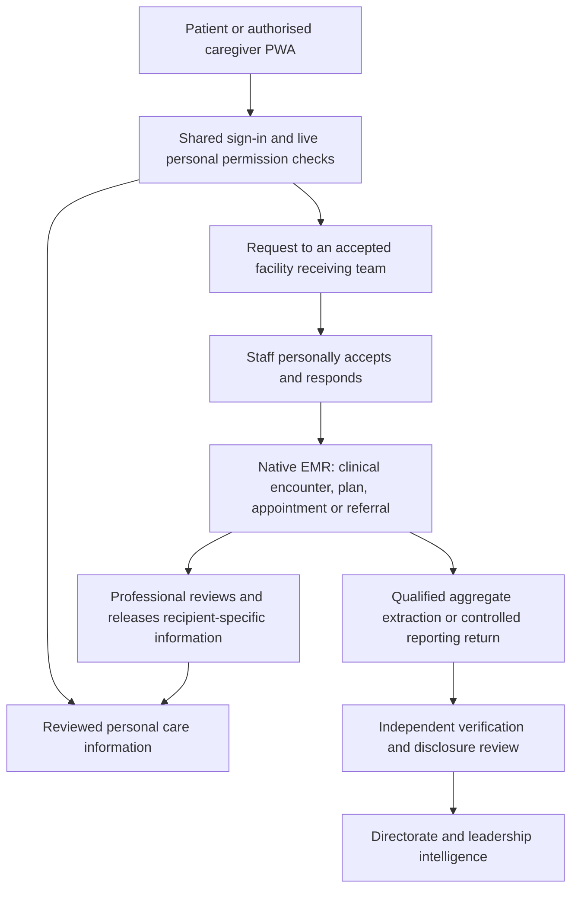

# How personal and family care connects to the platform

The delivered architecture is one cloud platform with a separately launchable **My LW Health Care PWA** and connected staff workspaces. It is not a separately hosted patient backend. The production patient route is [My LW Health Care](https://lw-health-intelligence.vercel.app/my-health); clinical staff use [LW Care](https://lw-health-intelligence.vercel.app/care), receiving teams and records staff use [Patient access](https://lw-health-intelligence.vercel.app/patient-access), and Directorate officers use [Reporting and intelligence](https://lw-health-intelligence.vercel.app/directorate).

## Accounts and family profiles

1. Open the personal portal and create an account, or use an existing verified platform account. Public access does not require ministry membership.
2. Follow the private email link, set a password and register an authenticator. An installed browser context may request sign-in again.
3. Request a link to your actual facility patient identity. Facility records staff independently verify the person, relationship/authority, allowed actions, expiry and next review. Registering an account does not open a clinical chart.
4. Select yourself or an explicitly authorised family subject. Each permission controls reading, requests and sharing independently. Representatives cannot delegate onward; a family label alone does not grant access.
5. Switching subjects clears the prior care view, conversation and visible drafts. Expired, changed or revoked permission requires renewed verification.

## Remote interaction today

The patient selects an available receiving service and sends a care, correction or personal-update request. Both the named primary and fallback professionals must have accepted coverage before that service becomes selectable. The patient sees submission status, responsible team, expected update and human responses. Submission is distinct from a clinician accepting/reviewing it. An interrupted submission retains its operation key in the current tab; the patient should check request history before creating a new request after restarting.

Staff personally accepts responsibility, responds and records follow-up. Clinical examination, documentation, signing and scheduling remain in the authorised EMR workflow. Confirmed appointments and reviewed plans/medicines/results can be released to the specific verified personal permission. Patient self-reports remain attributed statements; they do not change prescribed instructions or become verified adherence.

The current remote channel is asynchronous text. Live video/audio consultation, automated clinical chat, automatic appointment booking and emergency dispatch are not delivered by the PWA packaging.

## Referrals today

Clinical staff coordinates the referral in the native EMR using the actual clinical summary, sharing authority, owner and recorded receiving acceptance/handover. A patient's care request does not itself establish an accepted referral. Staff can communicate actual arrangements through the owned request conversation or a reviewed care summary. The personal app does not yet contain a dedicated structured referral tracker or receiving-facility integration.

Future referral and remote-consultation additions should preserve this distinction: requested → actually accepted → actual transfer/consultation → outcome and retained follow-up. Equipment/system connections follow facility registration, approval and adopted service readiness.

## Installation and connectivity

The personal portal offers installation when the browser provides its install prompt. Otherwise use the browser's Install app/Add to Home Screen control; on Safari for iPhone/iPad use Share → Add to Home Screen. The installed experience has its own My LW Health Care name and care icon. Browser support and installation controls vary; see the [MDN installation guide](https://developer.mozilla.org/en-US/docs/Web/Progressive_web_apps/Guides/Installing).

Protected information and new requests require an internet connection. The worker's offline screen contains connection guidance only; it does not retain charts or queue clinical requests. It does not provide the facility-local offline EMR, whose installation remains deferred. Actual device installation/accessibility journeys remain operating qualification work, separate from engineering checks and cloud deployment.

## Directorate relationship

Personal charts are not opened to leadership dashboards. Directorate reporting uses authorised, verified and disclosure-controlled data. The native EMR is an available clinical source; participating facilities may also use controlled returns or approved existing-system routes. No second EMR or imaging connection is a prerequisite for the reporting portal. The next Director-first priorities remain actual template/roster adoption, reporting completeness, independent verification, dashboards and accountable intervention.
